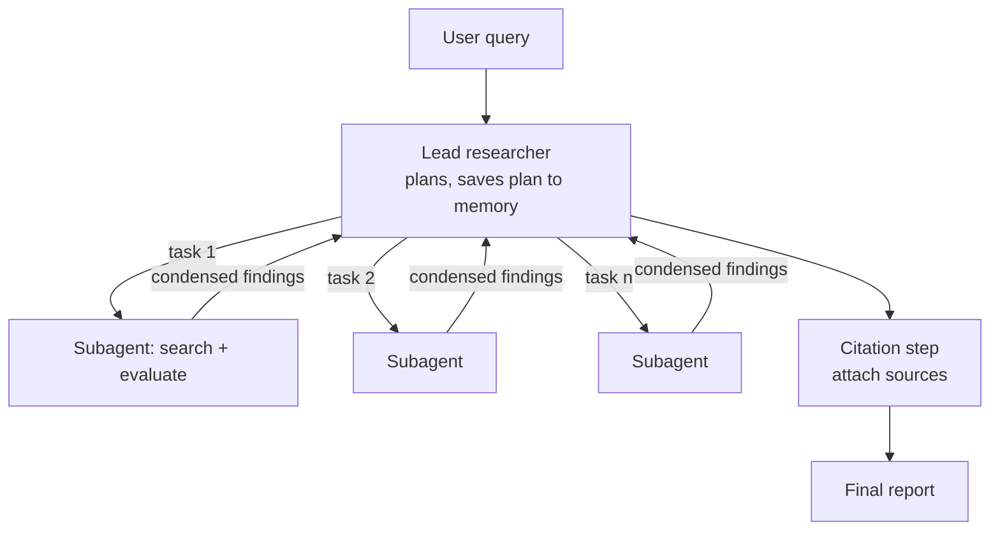

# Case study 01 — Anthropic's multi-agent research system

**Source:** [How we built our multi-agent research system](https://www.anthropic.com/engineering/multi-agent-research-system) (Anthropic Engineering)

## TL;DR
For open-ended research (many independent directions to explore), a **lead agent that plans and spawns parallel subagents** beat a single agent by a wide margin on Anthropic's internal research eval. It also burned far more tokens. The engineering effort went into **prompting the lead to delegate well**, **tool design**, **evals** and **production reliability**, not into exotic orchestration.

## Context
Claude's Research feature has to search the web and connected sources, follow leads, and synthesize an answer. Research is *breadth-first and path-dependent*: you can't script the steps in advance, and many sub-questions are independent.

## Architecture

- Lead: a strong model that decomposes the question and decides how many subagents to run.
- Subagents: run **in parallel**, each with its own context window, own searches, and return compressed findings.
- The plan is saved to memory, because long research can exceed one context window.

## Key decisions & trade-offs

| Decision | Why | Cost / risk |
|---|---|---|
| Multi-agent for research | Independent sub-questions → parallel exploration, more total "thinking" across contexts | Many more tokens; coordination bugs |
| Teach the lead to delegate (objective, output format, tools, boundaries per subtask) | Vague tasks caused duplicated or missed work | Longer, carefully engineered prompts |
| Scale effort to query complexity (rules in the prompt) | Simple facts don't need 10 subagents | Needs judgment encoded as heuristics |
| Parallel tool calls + parallel subagents | Big wall-clock reduction on complex queries | Synchronous fan-out = lead waits for the slowest subagent |
| LLM-as-judge with a rubric + human review | Research quality is subjective; humans caught edge cases evals missed | Judge calibration work |

## Numbers worth remembering (as reported in the post)
- Multi-agent (lead: Claude Opus 4, subagents: Claude Sonnet 4) outperformed single-agent Claude Opus 4 by **90.2%** on their internal research eval.
- **Token usage alone explained 80%** of the performance variance on BrowseComp in their analysis (three factors together explained 95%): more tokens spread across parallel contexts ≈ more capability.
- Typical token multipliers vs a chat interaction: agents **~4×**, multi-agent systems **~15×**. Multi-agent only pays off for **high-value** tasks.
- Parallelism (lead spins up 3–5 subagents at once; subagents use 3+ tools in parallel) cut research time by **up to 90%** for complex queries.
- A tool-testing agent that rewrote poor tool descriptions led to a **40% decrease in task completion time** for future agents. Tool design matters this much.
- The lead saves its plan to memory because context beyond **200,000 tokens** gets truncated.

## What to apply to ShopEase
- **Don't** make support multi-agent by default. A support reply is a *single write* to one customer, and tasks are cheap and tightly coupled.
- **Do** use a read-only **investigation subagent** for complex complaints (Day 9 capstone milestone): it reads many orders/policies and returns a structured case summary, and the main agent stays the only writer.
- Put "how much effort to spend" rules in the prompt, e.g. "1 lookup for status questions; investigate only for multi-order complaints."

## Discussion questions
1. Why does research parallelize well but writing code often doesn't?
2. If multi-agent costs ~15× a chat, what must be true about the task's value for it to be worth it?
3. Which of the post's delegation rules would fix a subagent that keeps repeating the lead's searches?
4. How would you evaluate a system whose "correct" answer is a long, subjective report?

## Related
Day 9 theory · [Case study 02](02-cognition-single-threaded-agents.md) gives the opposing view · [Video walkthrough (community)](https://www.youtube.com/watch?v=0HljLKVdtjo)
