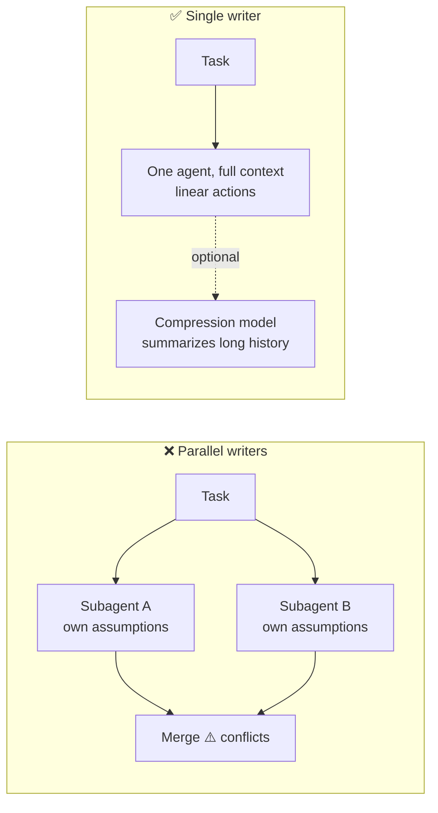

# Case study 02 — Cognition: "Don't Build Multi-Agents" (and what does work)

**Sources:** [Don't Build Multi-Agents](https://cognition.ai/blog/dont-build-multi-agents) (Walden Yan, Cognition, June 2025) · follow-up: [Multi-Agents: What's Actually Working](https://cognition.ai/blog/multi-agents-working) (2026)

## TL;DR
Cognition (makers of the Devin coding agent) argue that **context engineering, not agent count, decides reliability**. When parallel subagents make decisions about a *shared artifact* (a codebase) without each other's full context, their outputs **conflict**. Their recommendation: a **single-threaded** agent with excellent context management. Their later post narrows this: many agents can contribute *intelligence*, but **writes stay single-threaded**.

## The core argument, in two principles
1. **Share context, and share full agent traces, not just messages.** A subagent that only sees its task description misses the decisions made elsewhere.
2. **Actions carry implicit decisions, and conflicting decisions produce bad results.** Each "small" choice (style, library, assumption) is a decision that other parts must agree with.

The post's illustration: split "build a Flappy Bird clone" into subtasks. One subagent builds a background in a completely different visual style, another builds a bird that doesn't match. Each subtask is "done", but the result doesn't fit together.

For very long tasks, they suggest a separate model that **compresses history** (key decisions and events) so a single agent can keep going without losing what matters.

## Reconciling with Anthropic (case study 01)

| | Anthropic research | Cognition coding |
|---|---|---|
| Work type | Breadth-first, independent, read-only | Tightly coupled writes to shared state |
| Multi-agent? | ✅ helps | ❌ hurts (unless writes are single-threaded) |
| Shared lesson | Context engineering is the #1 job | Context engineering is the #1 job |

**Rule you can use everywhere:** *many readers, one writer.*

## What to apply to ShopEase
- The agent that talks to the customer and issues refunds is the **only writer**. Any helper (investigator subagent, policy researcher) is read-only and returns structured findings.
- Don't split a reply into parts written by different agents (tone and promises will conflict).
- For long conversations, use **compaction** (Day 5) rather than handing the conversation off between agents.

## Discussion questions
1. Name a ShopEase feature where two parallel agents would make conflicting decisions.
2. What exactly should a compression model keep from a 2-hour coding session?
3. Why might "share full traces" be expensive, and how would you limit it?

## Related
Day 5, Day 9 · [Case study 01](01-anthropic-multi-agent-research.md)
