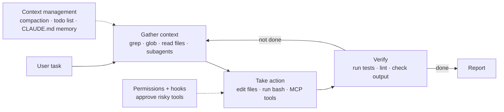

# Case study 03 — The Claude Code agent loop

**Sources:** [How the agent loop works (Claude Agent SDK docs)](https://code.claude.com/docs/en/agent-sdk/agent-loop) · [Building agents with the Claude Agent SDK](https://claude.com/blog/building-agents-with-the-claude-agent-sdk) · [Claude Code best practices](https://code.claude.com/docs/en/best-practices) · [Effective context engineering](https://www.anthropic.com/engineering/effective-context-engineering-for-ai-agents)

> 🔎 **Deep dive:** this is the short version. The full 4-part guide is in [claude-code/](claude-code/README.md).

## TL;DR
One of the most capable agents in production is built on the loop you wrote on Day 3: **gather context → take action → verify → repeat**. What makes it strong isn't orchestration complexity. It's **general-purpose tools** (files, search, bash), **context management** (just-in-time retrieval, compaction, subagents), **verification** (tests, linters) and **permissions/hooks** for safety. The same harness is available as a library, the Claude Agent SDK.

## Architecture

## Key design decisions & trade-offs

| Decision | Why | Trade-off |
|---|---|---|
| **Single main loop**, flat message history | Simple to reason about and debug; strong models plan by themselves | Long tasks need context management |
| **Agentic search** (grep/glob/read) over a vector index for code | Precise, always fresh, transparent | More tool calls than one retrieval |
| **Bash as a universal tool** | Thousands of CLIs without writing tools | Needs permissions + sandboxing |
| **Todo list** the model maintains | Keeps the plan visible near the end of context | A few more tokens |
| **Subagents** for exploration | Isolate noisy context, return summaries | Extra tokens; info lost in summaries |
| **Compaction** when context fills | Sessions longer than one window | Summaries can drop details |
| **CLAUDE.md** project memory files | Durable, human-editable procedural memory | Must be kept short and current |
| **Permissions + hooks** | Human control over risky actions; automate checks | Approval fatigue if overused |

## Practices from the best-practices guide worth copying
- Give the agent a way to **verify its work** (tests, screenshots, expected outputs). It's the single biggest quality lever.
- **Tell Claude what it can't see:** name the file, describe the symptom, say what "fixed" looks like; for fuzzy tasks, have it interview you and write a spec first (then use plan mode).
- Use a Markdown checklist / scratchpad for multi-step tasks.
- Run headless (`claude -p`) for automation and CI.

## What to apply to ShopEase
- Your Day 3 loop *is* the architecture, so invest in tools, context and verification instead of orchestration.
- "Verify before finishing" for support = **check eligibility before promising a refund** (that's in the system prompt and in the evals).
- Keep a short, stable system prompt (cacheable) and load customer context just in time.

## Discussion questions
1. Why would a coding agent prefer grep over embeddings, while a support FAQ bot might prefer hybrid RAG?
2. Which ShopEase tools need a permission prompt, and which never should?
3. What is ShopEase's equivalent of "run the tests"?

## Related
Days 3, 5, 14 · [Day 14 notebook: Claude Agent SDK section](../week-3/practice/day-14-frameworks.ipynb)
