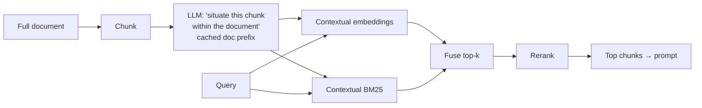

# Case study 04 — Contextual Retrieval

**Source:** [Introducing Contextual Retrieval](https://www.anthropic.com/engineering/contextual-retrieval) (Anthropic, 2024)

## TL;DR
Chunks lose their meaning when cut out of a document ("Revenue grew 3% over the previous quarter": which company? which quarter?). **Contextual Retrieval** prepends a short, LLM-generated explanation to each chunk *before* indexing it, for both embeddings and BM25. Combined with **reranking**, Anthropic reported large drops in retrieval failures. **Prompt caching** makes the preprocessing cheap.

## The pipeline

## Numbers worth remembering (as reported)
- Contextual embeddings cut the top-20 retrieval failure rate by about **35%**.
- Contextual embeddings + contextual BM25: about **49%** fewer failures.
- Adding **reranking** on top: about **67%** fewer failures.
- With prompt caching, generating contexts cost roughly **$1 per million document tokens** (one-time).
- If the whole knowledge base fits in the prompt (on the order of ~200K tokens), **skip RAG** and just include it, with caching.

## Decisions & trade-offs

| Decision | Benefit | Cost |
|---|---|---|
| Add context to every chunk | Chunks retrievable by their meaning in context | One LLM call per chunk (cheap with caching) |
| Hybrid embeddings + BM25 | Catches exact terms (ids, codes) and meaning | Two indexes to maintain |
| Rerank top candidates | Big precision gain | Extra latency per query |
| "Just put it all in the prompt" for small corpora | Simplest, no retrieval errors | Cost/latency grow with corpus size |

## What to apply to ShopEase
- The policy corpus is tiny, so a defensible choice is **no RAG at all**: put all policies in the cached system prompt. Measure both!
- The capstone's `rag.py` already does a cheap version of contextualization: every chunk is prefixed with its document title (`[Returns policy] ## Return window ...`).
- Day 6 exercise: replace the title prefix with an LLM-generated sentence and compare recall@3.

## Discussion questions
1. Why does BM25 benefit from contextualization, not just embeddings?
2. At what corpus size would you switch ShopEase from "everything in the prompt" to RAG?
3. How would you evaluate retrieval separately from answer quality?

## Related
Day 6 theory and notebook · [`shopease/rag.py`](../projects/shopease-support-agent/shopease/rag.py)
