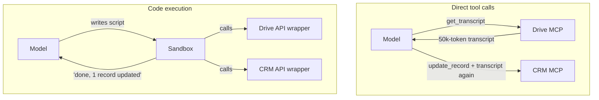

# Case study 05 — Code execution with MCP: tools as code, data out of the context

**Sources:** [Code execution with MCP: Building more efficient agents](https://www.anthropic.com/engineering/code-execution-with-mcp) (Anthropic) · Cloudflare published similar findings under the name "Code Mode"

## TL;DR
When an agent connects to many MCP servers, two costs explode:
1. **Tool definitions** are loaded into every request (the "tool tax").
2. **Intermediate results** flow through the model, e.g. a full meeting transcript copied from one tool call into the next.

The fix: present MCP servers as a **code API on a filesystem** that the agent explores on demand, and let it **write code** that calls the tools and moves data *inside a sandbox*. Only the final, small result reaches the model.

## Before vs after

## Numbers worth remembering (as reported)
- An example workflow dropped from roughly **150,000 tokens to ~2,000 tokens** (about a **98.7%** reduction).

## Benefits and costs

| Benefit | Why |
|---|---|
| **Progressive disclosure** | The agent lists/reads only the tool files it needs instead of loading every definition |
| **Context-efficient results** | Filter, aggregate and join data in code; return only the answer |
| **Control flow in code** | Loops, retries and conditionals without a model round-trip per step |
| **Privacy** | Intermediate data can stay in the sandbox and be tokenized before the model sees it |
| **Reusable skills** | Working scripts can be saved and reused |

| Cost | Mitigation |
|---|---|
| Needs a **secure sandbox** (resource limits, no unintended network access, monitoring) | Managed code-execution tools or hardened containers (Day 10) |
| More moving parts than plain tool calls | Use only when tool count or data size makes direct calls painful |

## When to use which

| Situation | Choose |
|---|---|
| < ~20 tools, small results | Plain tool calls (simplest) |
| Many servers/tools | Tool search / deferred loading, or code-as-API |
| Large data passing between tools | Code execution (data stays in the sandbox) |
| Business actions needing approval (refunds) | Plain tools with approval gates (easier to audit) |

## What to apply to ShopEase
- Customer-facing refunds stay **plain tools with approval gates**: auditability matters more than tokens.
- The Day 10 "ops analytics" mode is the right place for code: managers ask aggregate questions over many orders.

## Discussion questions
1. Why does passing a transcript through the model *twice* cost so much more than once?
2. What could go wrong if the sandbox had unrestricted network access?
3. Which is easier to audit for compliance: 10 tool calls or 1 script? Why?

## Related
Day 8 (tool tax), Day 10 (sandboxes) · [Claude docs: code execution tool](https://platform.claude.com/docs/en/agents-and-tools/tool-use/code-execution-tool)
