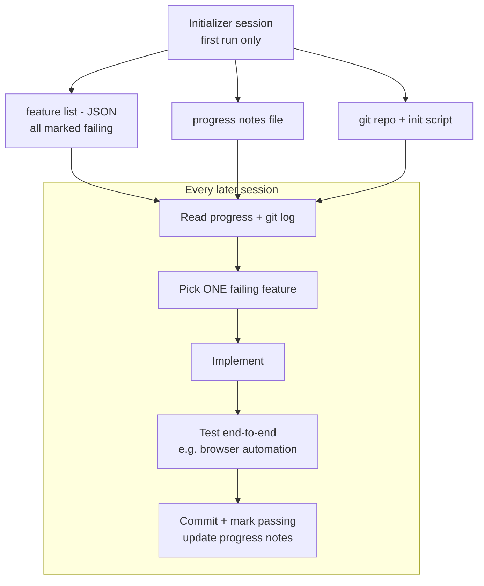

# Case study 06 — Harnesses for long-running agents

**Sources:** [Effective harnesses for long-running agents](https://www.anthropic.com/engineering/effective-harnesses-for-long-running-agents) (Anthropic) · follow-up: [Harness design for long-running apps](https://www.anthropic.com/engineering/harness-design-long-running-apps) · [Building a C compiler with parallel Claudes](https://www.anthropic.com/engineering/building-c-compiler)

## TL;DR
Some tasks take many hours, far more than one context window. Each new session starts with **no memory**, like a new engineer on every shift. The fix is a **harness**: an initializer session that sets up the environment, and then coding sessions that each **read the progress notes, do one increment, test it, commit, and update the notes**. Structured state (JSON) and git make progress durable and verifiable.

## Architecture

**Concrete details from the post:** in their example (a claude.ai clone) the feature list had **over 200 features**, each a JSON entry with a boolean `"passes": false` until verified. Progress notes lived in `claude-progress.txt`, plus git commits with descriptive messages. End-to-end checks used screenshots through the **Puppeteer MCP server**.

## Failure modes they reported, and the fixes

| Failure mode | Fix in the harness |
|---|---|
| Trying to build everything at once, then running out of context mid-way | Work on **one feature per session** |
| Declaring the job finished too early | An explicit feature list where every item must be verified as passing |
| Marking features done without real testing | End-to-end tests (browser automation) before marking passing |
| Losing track between sessions | Progress notes + descriptive git commits, read at the start of every session |
| Model editing the plan file inappropriately | Keep state in **JSON**, which the model was less likely to rewrite than Markdown |

## The evolution
The follow-up post describes a planner / generator / evaluator split for building full apps. It also notes that newer models need **less scaffolding**: some resets and workarounds could be removed as models improved. That's the same pattern as Day 1, where architectures get simpler as models get better.

## What to apply to ShopEase (and your own projects)
- Your Day 15 design doc + eval report work like a "progress file" for humans and agents.
- When you use a coding agent to build the capstone: keep a `features.json` checklist with tests and ask for **one feature per session**.
- Memory (Day 7) and context engineering (Day 5) are what make long-running agents possible.

## Discussion questions
1. Why is "one feature per session" better than "as much as possible per session"?
2. What is the minimum state a new session needs in order to continue safely?
3. Which parts of this harness would you remove first as models get stronger, and how would you know it's safe?

## Related
Days 5, 7, 15 · [Case study 03](03-claude-code-agent-loop.md)
