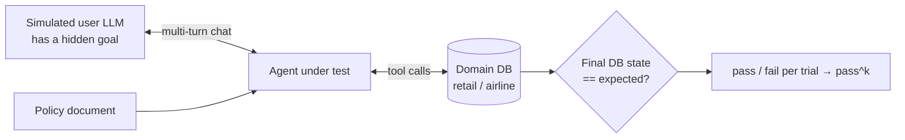

# Case study 07 — Customer-service agents & τ-bench: policy-following and consistency

**Source:** [τ-bench: A Benchmark for Tool-Agent-User Interaction in Real-World Domains](https://arxiv.org/abs/2406.12045) (Sierra, 2024)

## TL;DR
τ-bench tests exactly what ShopEase does: an agent with **domain tools** (a database API), a **policy document** it must follow, and a **simulated user** who chats over multiple turns. Success is judged by comparing the **final database state** with the expected one, not by grading the text. It popularized **pass^k** (succeed on *all* k tries), because customers notice inconsistency. In its original results, even strong function-calling agents solved fewer than half of the tasks and were much less reliable across repeated trials.

## How the benchmark works

Domains: **retail** (orders, returns, exchanges) and **airline** (bookings, changes, baggage), each with rules the agent must follow even when the user pushes back.

## Numbers worth remembering (from the paper's abstract)
- Even state-of-the-art function-calling agents (e.g. gpt-4o at the time) succeeded on **< 50%** of tasks.
- They were inconsistent: **pass^8 < 25%** in retail.

## Why its design choices matter

| Choice | Why it's smart | ShopEase equivalent |
|---|---|---|
| Grade the **final state**, not the words | Many valid conversations reach the same correct outcome | `refunds` checks in `evals/cases.jsonl` |
| **Simulated user** with a goal | Tests multi-turn behavior, clarifying questions, pushback | Add a user-simulator to your evals (exercise) |
| **Policy document** the agent must follow | Real support is mostly rule-following under pressure | Returns/shipping policies + code-enforced rules |
| **pass^k** | Consistency is what customers experience | `run_evals.py --repeats 3` reports pass^3 |

## What to apply to ShopEase
- Keep grading **outcomes** (DB state) and a few **critical trajectory checks** (eligibility called before refunds).
- Put rules that must always hold in **code** (eligibility, approval limits). The paper's failure cases include agents violating policy when users insist.
- Track **pass^3** before launch, not just the pass rate.

## Discussion questions
1. Why is grading final DB state more robust than grading the reply text?
2. Build a simple user simulator for ShopEase: what hidden goal and pushback would you give it?
3. Your agent has 85% per-try success. What pass^8 does that imply? Is it launchable for support?

## Related
Day 11 (evals), capstone [`evals/`](../projects/shopease-support-agent/evals/)
