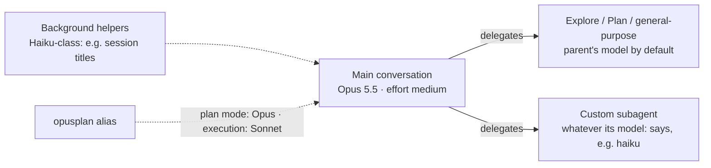
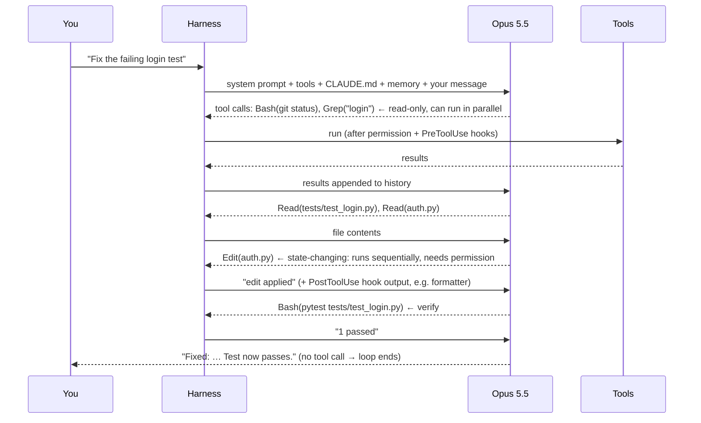
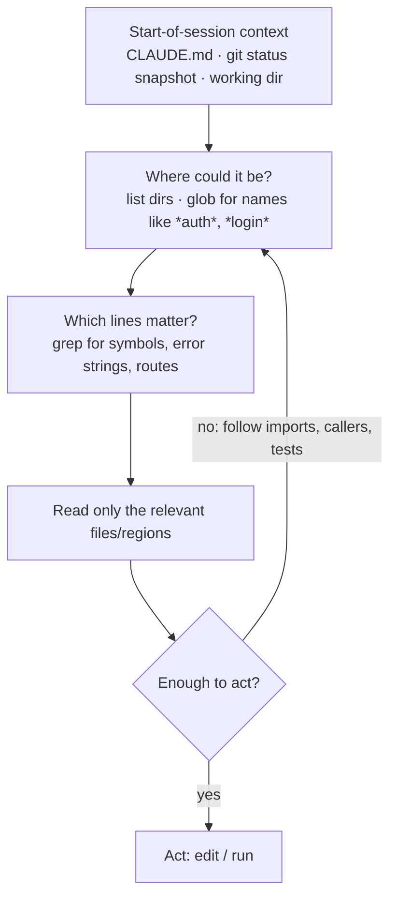

# 1 · Architecture, models & the agent loop

[← Guide index](README.md) · [Next: Context, memory & prompts →](02-context-memory-and-prompts.md)

**In one sentence:** Claude Code runs a loop. The model decides the next action, the harness executes it as a tool call, and the result goes back to the model. This repeats until the model answers without calling a tool.

---

## 1.1 Model vs harness

📘 The docs describe it this way: *"The agentic loop is powered by two components: models that reason and tools that act. Claude Code is the layer around the model that provides the tools and manages the context the model sees. This surrounding layer is what the term **agentic harness** refers to."* ([How Claude Code works](https://code.claude.com/docs/en/how-claude-code-works))

| The model (Opus 5.5) does | The harness (Claude Code) does |
|---|---|
| Reads the whole context and decides the next step | Builds that context: system prompt, tool list, CLAUDE.md, memory, history |
| Writes text and structured tool calls | Executes tools on your machine (shell, files, web, MCP) |
| Reasons (adaptive thinking) between steps | Checks permissions, runs hooks, sandboxes commands |
| Decides when it's done | Manages the context window: compaction, deferred tools, caching |
| Delegates by calling the Agent tool | Starts subagents with fresh contexts and returns their summaries |

🧠 **Why this matters to you:** when Claude Code does something smart or dumb, ask which half caused it. A wrong file edit is usually a *context* problem (it didn't see the right file) or a *verification* problem (no test to catch it), not a "the model is dumb" problem. Both are things you can fix: better CLAUDE.md, clearer task, a test command.

---

## 1.2 Which models run, and for what

### The main model
- 📘 The `default` alias resolves to **Opus 5.5** on Pro, Max, Team, Enterprise and the Anthropic API (and on Bedrock, Google Cloud and Claude Platform on AWS). ([Model configuration](https://code.claude.com/docs/en/model-config))
- 📘 Aliases you can pass to `/model` or `claude --model`: `opus` (Opus 5.5), `sonnet` (Sonnet 5.5), `haiku` (Haiku 5.5), `fable` (Fable 5.2), `best`, `default`, plus `opusplan` = **Opus while in plan mode, Sonnet while executing**.
- 📘 Precedence (highest first): `/model` in the session → `--model` flag → `ANTHROPIC_MODEL` env var → `model` in settings → `ANTHROPIC_DEFAULT_MODEL`.
- 📘 Each model has its own prompt cache, so **switching models mid-session makes the next request uncached** (slower and more expensive once). ([Prompt caching](https://code.claude.com/docs/en/prompt-caching))

### Thinking and effort
- 📘 Opus 5.5 always uses **adaptive thinking**, which can't be switched off. You control *how much* with **effort**: `low · medium · high · xhigh · max`. **Opus 5.5 defaults to `medium`.**
- 📘 Change it with `/effort` (slider), `/effort high`, `--effort`, or `CLAUDE_CODE_EFFORT_LEVEL`. Skills and subagents can set their own effort in frontmatter. Writing **`ultrathink`** in a prompt asks for deeper reasoning on that turn.

| Use effort… | For |
|---|---|
| `low` | Renames, small edits, quick questions, mechanical refactors |
| `medium` (default) | Most day-to-day coding |
| `high` / `xhigh` | Hard bugs, architecture, multi-file changes with subtle interactions |
| `max` | When correctness matters far more than time and tokens |

🧠 Effort trades thinking tokens (cost, latency) for quality. Lower effort also tends to mean fewer, more consolidated tool calls. Raise it per task, not permanently.

### Context window
- 📘 Opus 5.5 uses a **1M-token** window by default. Auto-compaction triggers around **~967K** tokens by default; it's configurable with `/autocompact` (details in [file 2](02-context-memory-and-prompts.md)).

### Fast mode
- 📘 `/fast` runs the **same model** "up to **2.5× faster** at a higher cost per token" (Opus 5.5: $8/$40 per MTok vs $4/$20 standard). Quality is unchanged. It's billed to usage credits on subscriptions.
- 📘 Turning it on mid-conversation means paying fast-mode *uncached* price for the whole context once, so **enable it at the start of a session**. ([Fast mode](https://code.claude.com/docs/en/fast-mode))

### Background / helper models
- 📘 A Haiku-class model handles **background functionality**. Session-title generation is the documented example, and `ANTHROPIC_DEFAULT_HAIKU_MODEL` controls which model that is. ([Env vars](https://code.claude.com/docs/en/env-vars))
- 📘 Built-in subagents: **Explore and Plan use the parent's model** (not Haiku, which is a common myth). `claude-code-guide` runs on **Haiku**; `statusline-setup` on **Sonnet**. ([Subagents](https://code.claude.com/docs/en/sub-agents))
- 📘 Subagent model resolution order: model passed for that call → `model:` field in the agent definition → `CLAUDE_CODE_SUBAGENT_MODEL` → the main conversation's model.

**So "how many models does it run?"**

🧠 A typical session has **one main model** doing the reasoning, **a small model** for background chores, and **as many subagent instances as get spawned**, each with its own model setting. The cost lever: put `model: haiku` on custom subagents doing simple, read-heavy work.

---

## 1.3 The loop, step by step

📘 Claude works through **three phases: gather context → take action → verify results**, and *"these phases blend together"*. A question may only need context gathering; a bug fix *"cycles through all three phases repeatedly."* *"Each tool use returns information that feeds back into the loop, informing Claude's next decision."*

**Facts about the loop** (📘 [Agent SDK: agent loop](https://code.claude.com/docs/en/agent-sdk/agent-loop)):
- A **turn** = one model output plus execution of its tool calls. The loop **ends when the model produces output with no tool calls**.
- **Read-only tools** (Read, Glob, Grep, read-only MCP tools) can run **concurrently** within one turn. **State-changing tools** (Edit, Write, Bash) run **sequentially**.
- In the SDK and headless mode you can cap turns (`max_turns`) and spend (`max_budget_usd`).
- 📘 **You can steer mid-run:** Esc stops the current tool call. A message you type while it works is read once the current calls finish, within the same turn.

---

## 1.4 The tools (the agent's hands)

📘 From the [tools reference](https://code.claude.com/docs/en/tools-reference). Tool names are also the names used in permission rules and hook matchers.

| Group | Tools | Permission? |
|---|---|---|
| **Read & search** | `Read`, `Glob`, `Grep`, `LSP` (code intelligence via plugins) | No (inside the working dir) |
| **Change files** | `Edit`, `Write`, `NotebookEdit` | Yes |
| **Run things** | `Bash` (or `PowerShell`), `Monitor` (stream a background command's output) | Yes (read-only commands auto-allowed) |
| **Web** | `WebSearch`, `WebFetch` | Yes (approval remembered per repo / domain) |
| **Delegate** | `Agent` (spawn subagent), `SendMessage`, `ListAgents`, `Workflow` | Mostly no |
| **Plan & track** | `EnterPlanMode`, `ExitPlanMode`, `TaskCreate/Get/List/Update`, `TaskStop`, `AskUserQuestion` | ExitPlanMode: yes |
| **Extend** | `Skill`, `ToolSearch` (loads deferred MCP tools), MCP resource tools, `mcp__server__tool` | Depends |
| **Schedule & isolate** | `CronCreate/Delete/List`, `EnterWorktree/ExitWorktree` | EnterWorktree: yes |

Notes:
- 📘 The tools reference says `Glob` and `Grep` are absent by default on some platforms (macOS, Linux, WSL). There, file search goes through `Bash` (e.g. `rg`, `find`). Check `/help` or the tools reference for your build.
- 📘 Task tools (`TaskCreate`…) are the default checklist on some models and opt-in on others. `TodoWrite` is the legacy version.
- 📘 MCP tools appear as `mcp__<server>__<tool>`, and by default only their **names** sit in context until `ToolSearch` loads the full definitions (see file 2).

---

## 1.5 How it decides which command to run and which file to read

📘 Claude Code uses **agentic search**: it explores the codebase with search and read tools on demand, instead of pre-indexing it into a vector database. ([Building agents with the Claude Agent SDK](https://claude.com/blog/building-agents-with-the-claude-agent-sdk))

🧠 The typical search strategy is a funnel, like a senior engineer joining a new repo:

What drives each choice (🧠, consistent with documented behavior):

| Signal | Effect on what it does |
|---|---|
| **Your words** ("the login test", an error message, a file path, `@file`) | Exact strings become grep queries; `@` mentions put the file straight into context |
| **CLAUDE.md** ("tests live in `tests/`, run `make test`") | Skips discovery and uses your stated commands and conventions |
| **Project files** (`package.json`, `pyproject.toml`, `Makefile`, CI config) | Tells it how to build, test and lint |
| **Error output** | Stack traces point to file:line, so it reads exactly there |
| **Cost of being wrong** | Read-only exploration first; state changes only once the target is clear |

**Read before edit.** 🧠 The edit tool replaces an exact string, so the model must have seen the current text. That's why Claude Code reads a file before changing it, and re-reads it if the file may have changed.

**How to help it:** give exact paths or `@file`, paste the error, say which command runs the tests, and put stable facts in CLAUDE.md. Every one of these removes search steps (time + tokens).

---

## 1.6 Why it keeps verifying (even after it "already processed" something)

📘 "Verify results" is one of the three loop phases. A core section of the best-practices guide is **"Give Claude a check to run"**: tests, a browser screenshot next to a mockup, a review by a *fresh* subagent that never saw the conversation (`/code-review`), asking for evidence (the command and its output), reviewing against a spec, or enforcing the check with a Stop hook. ([Best practices](https://code.claude.com/docs/en/best-practices))

🧠 Why re-checking is rational for an agent:
1. **Errors compound.** If each step is 95% reliable, 20 unchecked steps succeed only ~36% of the time (0.95²⁰). One cheap check after each risky step resets the odds.
2. **State goes stale.** Files change (formatters, hooks, your own edits, other processes). What it read 10 steps ago may no longer be true, so it re-reads before editing.
3. **Context gets compacted.** After compaction, details may be summarized away. 📘 Claude Code re-reads up to five recently edited files after compaction for exactly this reason.
4. **Its own output can be wrong.** A plausible-looking edit may not compile. Running the test is the only way to *know*.
5. **Checks are cheap, mistakes are expensive.** A 2-second `pytest -k login` is far cheaper than shipping a broken change.

**How to make verification efficient:** tell it the **narrowest** check ("run `pytest tests/test_login.py`, not the full suite"), keep tests fast, and add a [PostToolUse hook](03-extensibility-and-guardrails.md) that runs a formatter or linter automatically so it doesn't spend turns doing it.

---

## 1.7 When it uses web search / fetch

📘 The docs say Claude uses web tools to *"search the web, fetch documentation, look up error messages."* Both need permission, and approval is remembered per repo (WebSearch) or per domain (WebFetch). You can allow or deny domains, e.g. `WebFetch(domain:docs.python.org)`. ([Permissions](https://code.claude.com/docs/en/permissions))

🧠 Good reasons it reaches for the web:
- The question depends on **recent or version-specific** information (a new library release, changed API).
- An **error message it can't explain** from the code alone.
- You gave it a **URL** or asked it to "check the docs".
- Its **knowledge cutoff** may be out of date for the topic.

It usually *doesn't* search when the answer is in the repo. Local truth beats web truth. **Tip:** paste the docs link yourself; it's faster and avoids searching the wrong version.

---

## 1.8 How it decides what to test

🧠 Typical order (and what you can control):
1. **Find the project's way of testing:** CLAUDE.md first, then `package.json` scripts / `pytest.ini` / `Makefile` / CI workflows.
2. **Run the narrowest relevant test first** (the file or test name related to the change), then widen if that passes and the change is broad.
3. **If no test exists**, a careful agent writes a small one that reproduces the bug *before* fixing it, so the fix can be proven.
4. 🧠 A **test-first loop** works especially well with agents: tests first, confirm they fail, then implement until they pass without changing the tests. The test is an objective "done" signal the agent can check itself. 📘 It's one form of the best-practices advice to *give Claude a check to run*. A **Stop hook** can enforce it ("don't finish until tests pass").
5. 📘 Claude Code ships bundled skills such as `/verify` and `/run` (checking a change in the real app) and `/code-review` (a correctness review in a fresh subagent). Run `/help` to see what your version includes.

**Prompt template:** *"Write a failing test for X in `tests/test_x.py`, run it to confirm it fails, then fix the code until it passes. Don't modify the test."*

---

## 1.9 Subagents: when it fires which agent, and why

📘 *"Use one when a side task would flood your main conversation with search results, logs, or file contents you won't reference again."* Each subagent *"runs in its own context window with a custom system prompt, specific tool access, and independent permissions,"* and returns a **summary** to the main conversation. ([Subagents](https://code.claude.com/docs/en/sub-agents))

### Built-in subagents
| Agent | Model | Tools | Fires when… |
|---|---|---|---|
| **Explore** | parent's | read-only (no Write/Edit) | Broad codebase search: "where is X handled?" Thoroughness: quick / medium / very thorough. Skips CLAUDE.md for speed |
| **Plan** | parent's | read-only | Researching during plan mode |
| **general-purpose** | parent's | all subagent tools | Complex multi-step side tasks |
| **claude-code-guide** | Haiku | docs lookup | Questions about Claude Code itself |
| **statusline-setup** | Sonnet | — | `/statusline` |

### How the delegation decision works
- 📘 *"Claude uses each subagent's description to decide when to delegate tasks."* Put "use proactively" in a custom agent's description to encourage it. You can also force it: `@"code-reviewer (agent)"` or `claude --agent <name>`.
- 🧠 It delegates when **the work is noisy** (big searches, logs), **independent** (can run in parallel) or **specialized** (a reviewer with a different system prompt). It does *not* delegate tightly coupled edits. Splitting a single change across agents risks conflicting decisions ([case study 02](../02-cognition-single-threaded-agents.md)).

### Mechanics worth knowing (📘)
- A normal subagent **doesn't see your conversation**. It gets its own system prompt, the task message the main agent wrote, CLAUDE.md (except Explore/Plan), a git status snapshot and any preloaded skills. **So the main agent's delegation message is everything the subagent knows.**
- **Forks** inherit the parent conversation instead of starting fresh (`/subtask`; controlled by `CLAUDE_CODE_FORK_SUBAGENT`).
- Up to **20 concurrent** subagents by default, and nesting up to **3 levels** deep.
- Subagents can run in the **background**; their permission prompts surface in your main session. You can resume one later via `SendMessage`.
- Transcripts live under `~/.claude/projects/<project>/<session>/subagents/`.

🧠 **Cost reality:** subagents save *main-context* tokens but still spend their own. Use them for breadth (search, review, research), not as a default.

---

## 1.10 Planning: plan mode and task lists

📘 *"Plan mode tells Claude to research and propose changes without making them. Claude reads files, runs shell commands to explore, and writes a plan, but does not edit your source."* ([Permission modes](https://code.claude.com/docs/en/permission-modes))

- **Enter:** `Shift+Tab` (cycles modes), prefix a single prompt with `/plan`, or `claude --permission-mode plan`.
- **Approve:** the approval prompt offers *Yes, and use auto mode* / *Yes, manually approve edits* / *No, keep planning*. `Ctrl+G` opens the plan in your editor to edit it first.
- Plans are saved as files (default `~/.claude/plans/`), and the plan is **re-injected after compaction**.
- Claude can also enter plan mode by itself (`EnterPlanMode`) for big tasks.
- **Task lists** (`TaskCreate`/`TaskUpdate`, or the legacy `TodoWrite`) keep a visible checklist for multi-step work. 🧠 Like the todo list from course Day 3, the checklist keeps the plan near the end of the context, where attention is strongest.

🧠 **When to use plan mode:** whenever you couldn't describe the change in one sentence, or it touches more than ~3 files. Reviewing a plan takes 30 seconds; untangling a wrong 15-file change takes much longer.

---

## 1.11 A full worked trace

> *"Add rate limiting to the /login endpoint and test it."*

| Step | Phase | What happens | Part of the harness at work |
|---|---|---|---|
| 1 | Context | Session already loaded CLAUDE.md ("FastAPI app, tests: `pytest`, use `slowapi`") + git status | Memory |
| 2 | Context | You pressed Shift+Tab → plan mode. Claude greps for `/login`, reads `routes/auth.py`, `tests/test_auth.py` | Plan mode, read-only tools in parallel |
| 3 | Plan | Writes a plan: add a limiter, decorate the route, add 2 tests. You approve with "manually approve edits" | ExitPlanMode, permission mode |
| 4 | Act | Edit `requirements.txt`, `app.py`, `routes/auth.py`. Each edit is shown for approval | Permissions, checkpoints |
| 5 | Act | PostToolUse hook runs `ruff format` on edited files automatically | Hooks |
| 6 | Verify | `Bash(pytest tests/test_auth.py)` fails because the limiter isn't reset between tests | Bash, verify phase |
| 7 | Act | Reads the error, adds a fixture that resets the limiter | Loop: observation → new action |
| 8 | Verify | Re-runs: 2 passed. Then runs the full suite once: all green | Narrow → wide verification |
| 9 | Done | Summarizes the change and the commands it ran. No more tool calls, so the loop ends | Stop condition |

If something had gone wrong at step 4, **Esc Esc → rewind** would restore the files (see [file 4](04-power-features-and-playbook.md)).

---

**Next:** [2 · Context, memory & prompt management →](02-context-memory-and-prompts.md)
