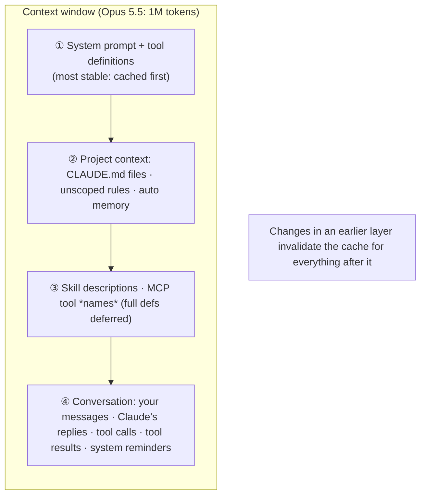

# 2 · Context, memory & prompt management

[← 1 · Architecture & loop](01-architecture-models-and-the-loop.md) · [Guide index](README.md) · [Next: Extensibility & guardrails →](03-extensibility-and-guardrails.md)

**In one sentence:** the model knows only what's in its context window, so most of Claude Code's design (and most of your skill as a user) is about putting the right things in that window and keeping the wrong things out.

---

## 2.1 What's in the context window

📘 Before you type anything, Claude Code loads: the **system prompt**, **auto memory** (`MEMORY.md`), **environment info** (working directory, platform, git status snapshot), **MCP tool names**, **skill descriptions**, and your **CLAUDE.md** files. Path-scoped rules and CLAUDE.md files in subdirectories load **on demand**. ([Context window](https://code.claude.com/docs/en/context-window))



As the session goes on, layer ④ grows fastest. File contents and command output are the big consumers. Run 📘 **`/context`** at any time to see a live breakdown by category, with suggestions.

🧠 **System reminders.** During a session the harness also injects short notes into the conversation, for example that a file changed on disk, that a hook said something, or that a background task finished. That's how the model "notices" events it didn't cause.

---

## 2.2 Context rot: why "more context" isn't free

🧠 (Course Day 5) Attention spreads over everything in the window. As it fills with stale logs and old file versions, the model gets **less reliable** at using any single fact, and instructions from early in the session may be followed less. Claude Code's context features all exist to fight this:

| Feature | What it does | When |
|---|---|---|
| **Subagents** | Keep noisy exploration out of the main window | Big searches, log digging, research |
| **Deferred MCP tools / ToolSearch** | Only tool *names* sit in context until needed | Always on for MCP by default |
| **Skills (progressive disclosure)** | Only skill *descriptions* load until a skill is used | Always |
| **Auto-compaction** | Summarizes the conversation near the limit | Automatic |
| **`/compact`** | Summarize now, optionally with a focus | At natural breakpoints |
| **`/clear`** | Start a fresh context (free) | Between unrelated tasks |
| **`/rewind` → summarize** | Summarize part of the conversation | Drop a long dead-end |

---

## 2.3 Compaction in detail

📘 *"Claude Code manages context automatically as you approach the limit. It compacts the conversation into a summary. The summary keeps your requests and key code snippets, but detailed instructions from early in the conversation may be lost."* ([How Claude Code works](https://code.claude.com/docs/en/how-claude-code-works))

**When:** 📘 for 1M-window models like Opus 5.5, around **~967K tokens** by default. Change it with `/autocompact 500k`, the `autoCompactWindow` setting, `--autocompact`, or `CLAUDE_CODE_AUTO_COMPACT_WINDOW` (minimum 100K). ([Model config](https://code.claude.com/docs/en/model-config))

🧠 Compacting *earlier* than the limit (e.g. at 300–500K) keeps the model sharper and each request cheaper. The cost is more frequent summaries.

**What survives compaction** (📘 [Context window](https://code.claude.com/docs/en/context-window)):
- ✅ System prompt and output style
- ✅ Project-root **CLAUDE.md** and unscoped rules, **re-read from disk**
- ✅ **Auto memory**, re-injected
- ✅ **Skill descriptions** rebuilt; skills you invoked are re-attached (up to 5K tokens each, 25K total)
- ✅ Up to **5 recently read/edited files** are re-read
- ✅ The current **plan** (re-injected from disk)
- ✅ Background commands and subagents keep running
- ⚠️ Path-scoped rules and nested CLAUDE.md come back only when a matching file is read again
- ❌ Fine details from early in the conversation (whatever the summary leaves out)

**Steering the summary:**
- `/compact focus on the API changes and the failing test`
- 📘 Add a **"Compact Instructions"** section to CLAUDE.md, e.g. *"When compacting, always keep: the list of modified files, the current test command, open TODOs."*
- 📘 *"Put persistent rules in CLAUDE.md rather than relying on conversation history."* Conversation can be compacted away; CLAUDE.md is re-read from disk.

📘 **Thrashing guard:** if one huge file or command output keeps refilling the window, Claude Code stops auto-compacting after a few attempts and shows an error. The fix is to stop pasting/reading that whole file and target the part you need.

---

## 2.4 Prompt caching: why a stable prefix matters

📘 *"Claude Code handles prompt caching for you."* Every request re-sends the full context, and the cache bills the repeated prefix at a fraction of the price and processes it much faster. The layers are ordered system prompt + tools → project context → conversation, so **a change in an earlier layer invalidates everything after it**. ([Prompt caching](https://code.claude.com/docs/en/prompt-caching))

| Breaks the cache (next request re-processes everything) | Keeps the cache |
|---|---|
| Switching **model** (`/model`) | Editing your repo files |
| Toggling **fast mode** | Editing CLAUDE.md mid-session (it isn't reloaded until `/clear`, `/compact` or restart) |
| Changing **effort**, on most models (Opus 5.5 keeps the cache on API key / subscription) | Changing permission mode |
| Adding/removing an **MCP server** (unless tool search defers its tools) | Invoking skills / commands |
| `/compact` or auto-compaction | `/rewind` |
| Upgrading Claude Code; many images | Spawning a subagent (it gets its own cache) |

📘 **Cache lifetime (TTL):** 5 minutes by default for API keys and cloud providers. On a Claude subscription the main conversation gets **1 hour** (subagents 5 min). Every request resets the timer. Check your hit rate in **`/usage`** ("Prompt cache" line, with miss causes).

🧠 **Practical rules:** pick your model and fast mode at the **start**. Avoid flipping models back and forth. After a long break (past the TTL), the first message re-processes the whole context. If the task changed anyway, `/clear` is the cheaper move.

---

## 2.5 Memory: how knowledge survives between sessions

📘 *"Each Claude Code session begins with a fresh context window. Two mechanisms carry knowledge across sessions: CLAUDE.md files … and auto memory."* ([Memory](https://code.claude.com/docs/en/memory))

### CLAUDE.md: memory *you* write

| Level | Location | Shared with | Typical content |
|---|---|---|---|
| **Managed (org policy)** | `/etc/claude-code/CLAUDE.md` (Linux), `/Library/Application Support/ClaudeCode/CLAUDE.md` (macOS), `C:\Program Files\ClaudeCode\CLAUDE.md` | Everyone in the org | Security/compliance rules |
| **User** | `~/.claude/CLAUDE.md` | Just you, all projects | Your personal style, preferred tools |
| **Project** | `./CLAUDE.md` or `./.claude/CLAUDE.md` | The team (commit it) | Build/test commands, architecture, conventions |
| **Local** | `./CLAUDE.local.md` | Just you, this project (git-ignore it) | Your sandbox URLs, local quirks |
| **Rules** | `.claude/rules/*.md` (and `~/.claude/rules/`) | As above | One topic per file; `paths:` frontmatter scopes a rule to matching files |

📘 **Loading:** files from the filesystem root down to your working directory load **at launch** and are **concatenated** (they don't override each other). CLAUDE.md files in **subdirectories load on demand**, when Claude works with files there. `@path/to/file` **imports** another file's content. Imports organize memory but **don't reduce** context cost. If there's no CLAUDE.md but there is an **`AGENTS.md`**, Claude reads that instead.

📘 **Two important truths:**
- *CLAUDE.md is context, not enforcement.* *"To block an action regardless of what Claude decides, use a PreToolUse hook instead."* (file 3)
- Keep each CLAUDE.md **under ~200 lines**. Move specialized instructions into **skills** or path-scoped **rules**.

### Auto memory: memory *Claude* writes
- 📘 Claude saves its own notes from your corrections and preferences. It's **on by default** in local sessions.
- 📘 Notes are stored in `~/.claude/projects/<project>/memory/`. The project is derived from the git repo, so worktrees share it. The first ~200 lines / 25KB of **`MEMORY.md`** load at every session start; topic files load on demand. It's **machine-local**.
- 📘 **`/memory`** lists and opens all memory files, and toggles auto memory on/off.
- 📘 Subagents don't get the main auto memory (forks do). A custom subagent can have its *own* memory via the `memory:` frontmatter field.

🧠 **Mental model:** CLAUDE.md is the **team handbook** (deliberate, reviewed, versioned). Auto memory is Claude's **personal notebook** about working with *you*. Review it occasionally with `/memory`, because wrong notes persist just like right ones.

### Writing a great project CLAUDE.md (start with `/init`, then edit)

```markdown
# Project: ShopEase support agent

## Commands
- Install: `pip install -r requirements.txt && pip install -e .`
- Test (fast, run after every change): `pytest projects/shopease-support-agent/tests -q`
- Single test: `pytest -k <name>`
- Evals (costs money, ask first): `python projects/shopease-support-agent/evals/run_evals.py`

## Architecture (1 line each)
- `shopease/tools.py`: all tools; business rules live HERE, not in prompts
- `shopease/agent.py`: the loop; don't add frameworks

## Conventions
- Never put the customer id in a tool argument; it comes from `Session`
- Prefer small functions; type hints everywhere

## Compact Instructions
Keep: files modified, current failing test, open TODOs.
```

| ✅ Put in CLAUDE.md | ❌ Keep out |
|---|---|
| Exact commands (build, test, lint, run) | Long tutorials (use skills) |
| Non-obvious conventions and "never do X" rules | Things the code makes obvious |
| Where important things live | Secrets and keys |
| How to verify a change | Instructions that change every week |

---

## 2.6 Skills: on-demand expertise (progressive disclosure)

📘 *"Create a SKILL.md file with instructions, and Claude adds it to its toolkit."* In a normal session **only skill descriptions** are in context. The **full content loads when the skill is invoked**, either automatically (Claude matches the description to the task) or manually (`/skill-name`). Custom slash commands have been merged into skills (`.claude/commands/` still works). ([Skills](https://code.claude.com/docs/en/skills))

```
.claude/skills/release-notes/
├── SKILL.md          ← frontmatter + instructions (keep < 500 lines)
├── template.md       ← supporting files, read only when needed
└── scripts/collect.sh
```

```markdown
---
name: release-notes
description: Write release notes from merged PRs. Use when the user asks for a changelog or release notes.
allowed-tools: Bash(gh pr list:*), Read
---
1. Run scripts/collect.sh to list merged PRs since the last tag.
2. Group by feature / fix / chore using template.md.
```

Useful frontmatter (📘): `description` / `when_to_use` (how Claude decides to use it), `disable-model-invocation: true` (only *you* can trigger it), `user-invocable: false` (only Claude can), `allowed-tools`, `model`, `effort`, `context: fork` (run in a subagent), `paths` (auto-activate for matching files).

Locations: `~/.claude/skills/` (personal), `.claude/skills/` (project), plugin `skills/` folders, and managed (org).

🧠 **Skill vs CLAUDE.md vs subagent:** CLAUDE.md = always-true facts (always loaded). Skill = a *procedure* needed sometimes (loaded on demand). Subagent = a *separate worker* with its own context.

---

## 2.7 Prompt management checklist (how to "prompt" Claude Code well)

🧠 Everything you send becomes context, so:
1. **One task per session** (or `/clear` between tasks). Mixed tasks blur the context.
2. **Be specific about scope and verification:** *"In `auth.py`, make `login()` reject expired tokens; run `pytest tests/test_auth.py`."*
3. **Point, don't paste:** use `@file` or paths instead of pasting big files; paste only the relevant error lines.
4. **Stable facts → CLAUDE.md, procedures → skills, one-off details → the prompt.**
5. **Course-correct early:** Esc as soon as it heads the wrong way. Don't let a wrong path fill the context.
6. **Use plan mode for anything non-trivial** (file 1 §1.10).
7. **Check `/context` when things feel off.** A bloated window is often the cause.

---

**Next:** [3 · Extensibility & guardrails →](03-extensibility-and-guardrails.md)
