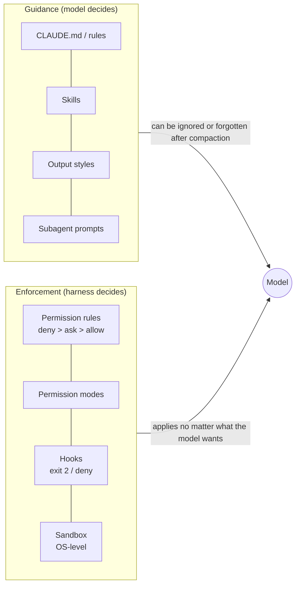
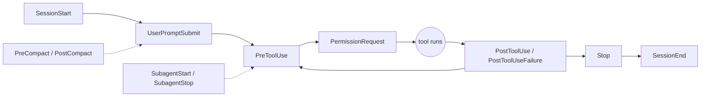

# 3 · Extensibility & guardrails: hooks, MCP, skills, plugins, permissions, sandbox

[← 2 · Context & memory](02-context-memory-and-prompts.md) · [Guide index](README.md) · [Next: Power features & playbook →](04-power-features-and-playbook.md)

**In one sentence:** CLAUDE.md and skills *ask* Claude to behave a certain way, while hooks, permission rules and the sandbox *make* it. Knowing which kind of tool to reach for is the core skill.



📘 *"CLAUDE.md content is context, not enforcement. To block an action regardless of what Claude decides, use a PreToolUse hook instead."* ([Memory](https://code.claude.com/docs/en/memory))

---

## 3.1 Hooks: your code runs at fixed points in the loop

**Simple explanation:** a hook is a script (or HTTP call, MCP tool or prompt) that Claude Code runs automatically when a specific event happens, such as before a tool runs, after a file is edited, or when Claude is about to stop. Hooks are **deterministic**: they always run, whatever the model "thinks". ([Hooks reference](https://code.claude.com/docs/en/hooks) · [Hooks guide](https://code.claude.com/docs/en/hooks-guide))

### Where hooks fire in the loop (📘 events)



| Group | Events |
|---|---|
| Session | `SessionStart` (startup / resume / clear / compact / fork), `SessionEnd`, `Setup` |
| Prompt | `UserPromptSubmit`, `UserPromptExpansion` (a slash command or MCP prompt expanded) |
| Tools | `PreToolUse`, `PermissionRequest`, `PermissionDenied`, `PostToolUse`, `PostToolUseFailure`, `PostToolBatch` |
| Agents / tasks | `SubagentStart`, `SubagentStop`, `TaskCreated`, `TaskCompleted`, `TeammateIdle` |
| Turn end | `Stop`, `StopFailure` |
| Context / memory | `PreCompact`, `PostCompact`, `InstructionsLoaded` |
| Other | `Notification`, `ConfigChange`, `CwdChanged`, `FileChanged`, `WorktreeCreate/Remove`, `PreModelSwitch`/`PostModelSwitch`, … |

### Configuration shape (📘)
Hooks live in `~/.claude/settings.json`, `.claude/settings.json`, `.claude/settings.local.json`, managed policy, plugins (`hooks/hooks.json`), or skill/subagent frontmatter. There are three levels: **event → matcher → handler(s)**.

```json
{
  "hooks": {
    "PostToolUse": [
      { "matcher": "Edit|Write",
        "hooks": [{ "type": "command", "command": "${CLAUDE_PROJECT_DIR}/.claude/hooks/format.sh", "timeout": 30 }] }
    ],
    "PreToolUse": [
      { "matcher": "Bash",
        "hooks": [{ "type": "command", "command": "${CLAUDE_PROJECT_DIR}/.claude/hooks/check-bash.sh", "onFailure": "block" }] }
    ]
  }
}
```

- **Matchers:** `"*"`/empty = all. Plain names or lists like `Edit|Write` match exactly. Anything else is a regex (e.g. `mcp__github__.*`).
- **Handler types:** `command`, `http`, `mcp_tool`, `prompt` (an LLM judges), `agent` (experimental).
- **Input:** JSON on stdin with `session_id`, `cwd`, `permission_mode`, `hook_event_name`, and per-event fields (`tool_name`, `tool_input`, `tool_response`…).

### How a hook talks back (📘)
| Mechanism | Effect |
|---|---|
| **Exit 0** | Success. Plain stdout becomes **context for Claude** on `UserPromptSubmit` / `SessionStart`; on `PreCompact` it becomes compaction instructions |
| **Exit 2** | **Blocking error.** The action stops and stderr is the reason Claude sees. On `PostToolUse` the tool already ran, so stderr is fed back to Claude |
| **Other non-zero** | Non-blocking error: a notice is shown and the action continues. **Use exit 2 for enforcement** |
| **JSON on stdout** | Fine-grained: `permissionDecision: allow/deny/ask/defer` (+ reason, `updatedInput`) on PreToolUse; `decision: "block"` on Stop/PostToolUse/UserPromptSubmit; `additionalContext` (≤10K chars); `continue: false` to stop Claude entirely |

📘 A hook's `allow` does **not** override your deny/ask permission rules. Use `"onFailure": "block"` for policy hooks so a crashing script fails *closed*.

### Recipes you'll actually use
**1. Block dangerous shell commands (PreToolUse, exit 2)**
```bash
#!/usr/bin/env bash
# .claude/hooks/check-bash.sh
cmd=$(jq -r '.tool_input.command')
if echo "$cmd" | grep -Eq 'rm -rf /|git push --force|DROP TABLE'; then
  echo "Blocked by project policy: $cmd" >&2
  exit 2
fi
```

**2. Auto-format after every edit (PostToolUse on `Edit|Write`)**
```bash
#!/usr/bin/env bash
file=$(jq -r '.tool_input.file_path')
case "$file" in *.py) ruff format "$file" >/dev/null ;; *.ts|*.js) npx prettier -w "$file" >/dev/null ;; esac
```

**3. Don't let Claude stop until tests pass (Stop hook)**
```bash
#!/usr/bin/env bash
# Exit 2 on a Stop hook = "don't stop yet"; stderr is shown to Claude as the reason.
if ! pytest -q >/tmp/test.log 2>&1; then
  { echo "Tests are failing; fix them before finishing:"; tail -20 /tmp/test.log; } >&2
  exit 2
fi
```
🧠 Keep Stop hooks fast and make sure they *can* pass. A check that never succeeds keeps the agent looping (and spending). If you want JSON instead, print **only** a single JSON object to stdout, e.g. `{"decision": "block", "reason": "tests failing"}`, with no other text.

**4. Inject fresh context at session start (SessionStart stdout → context):** print the current sprint goal, today's on-call notes, or `git log --oneline -5`.

📘 **Security:** hooks run arbitrary commands *as you*. Review project and plugin hooks before trusting a repo. Organizations can force managed-only hooks (`allowManagedHooksOnly`).

🧠 **When to use a hook vs CLAUDE.md:** if breaking the rule would be *bad* (deleting data, committing secrets, skipping formatting in CI), use a hook. If it's a *preference* (naming style), CLAUDE.md is enough.

---

## 3.2 MCP in Claude Code

**Simple explanation:** MCP servers plug extra tools and data into Claude Code (GitHub, databases, Sentry, browsers…), exactly as in course Day 8. ([MCP](https://code.claude.com/docs/en/mcp))

### Adding servers (📘)
```bash
claude mcp add --transport http github https://api.githubcopilot.com/mcp/        # remote (recommended)
claude mcp add --transport stdio --env API_KEY=xyz airtable -- npx -y airtable-mcp-server   # local process
claude mcp list            # see servers;  claude mcp remove <name>;  /mcp inside a session
```

| Scope | Stored in | Who gets it |
|---|---|---|
| `local` (default) | `~/.claude.json` under this project | You, this project |
| `project` | `.mcp.json` at repo root (commit it) | The whole team (each person approves it once) |
| `user` | `~/.claude.json` | You, all projects |

Name collisions resolve **local > project > user > plugin > claude.ai connectors** (managed servers outrank all). `.mcp.json` supports `${VAR}` and `${VAR:-default}` expansion, so secrets stay in env vars.

### How MCP tools behave inside the loop (📘)
- Tools are named **`mcp__<server>__<tool>`**. Use that name in permission rules, hook matchers and subagent `tools:` lists.
- **Tool search (deferred loading)** is on by default for current models. Only tool *names* sit in context, and `ToolSearch` loads a definition when needed. `ENABLE_TOOL_SEARCH=auto` loads everything upfront while definitions are under 10% of the window; `alwaysLoad: true` pins a server's tools.
- **Resources** appear in `@` autocomplete: `@server:protocol://path` attaches them. **MCP prompts** appear as slash commands.
- **Output limits:** `MAX_MCP_OUTPUT_TOKENS` (default 25,000). Very large text results are saved to a file and referenced instead of being pasted into context.
- **OAuth:** authenticate with `/mcp` (browser) or `claude mcp login <name>`. Headless runs can't complete OAuth, so log in interactively first.

📘 **Security:** only add servers you trust. Servers that fetch external content can carry **prompt injection**. Project `.mcp.json` servers need approval in interactive sessions (but load without a prompt in `-p`/SDK runs).

🧠 **Cost tip (also 📘 in the costs guide):** prefer a CLI the model already knows (`gh`, `aws`, `gcloud`) over an MCP server when both exist. Disable unused servers with `/mcp`.

---

## 3.3 Skills, custom commands, plugins and custom subagents

| Extension | What it is | Loaded into context | Use for |
|---|---|---|---|
| **Skill** (`.claude/skills/<name>/SKILL.md`) | Instructions + optional scripts/files | Description always; body only when used | Repeatable procedures: release notes, migrations, deploy checks |
| **Custom command** (`.claude/commands/x.md`) | Legacy form, now merged into skills | When you type `/x` | Same as skills (prefer skills for new work) |
| **Subagent** (`.claude/agents/<name>.md`) | A separate worker: own prompt, tools, model, permissions | Only its description in the main context | Reviewer, researcher, test-runner, anything noisy or specialized |
| **Plugin** | A bundle of skills + agents + hooks + MCP servers + output styles | Names/descriptions of what it adds | Sharing a setup across projects or teams |

### Skill arguments and dynamic context (📘)
- `$ARGUMENTS`, `$0`/`$1`, or named `arguments:`. Example: `/fix-issue 123` → `$ARGUMENTS = 123`.
- `` !`git diff HEAD` `` at the start of a line **runs before Claude reads the skill** and inlines the output. That's ideal for "review my diff" skills. These commands are still checked against permission rules.
- `allowed-tools:` pre-approves specific tools while the skill runs.

### A custom subagent (📘 format)
```markdown
---
name: code-reviewer
description: Reviews diffs for bugs and missing tests. Use proactively after any non-trivial change.
tools: Read, Grep, Glob, Bash(git diff *)
model: haiku
---
You are a strict senior reviewer. Look only at the diff. Report: bugs, missing tests, risky changes.
Output a short ranked list with file:line. Do not edit files.
```
Fields include `tools` / `disallowedTools`, `model` (`haiku`, `sonnet`, `opus`, `inherit`…), `permissionMode`, `maxTurns`, `skills`, `mcpServers`, `hooks`, `memory`, `effort`, `isolation: worktree`, `background`. Locations, highest priority first: managed → `--agents` flag → `.claude/agents/` → `~/.claude/agents/` → plugins.

### Plugins (📘)
- `/plugin` opens Discover / Installed / Marketplaces. Install as `name@marketplace` (e.g. from the official `claude-plugins-official` marketplace). Use `/reload-plugins` to apply changes without restarting.
- Plugin skills are namespaced (`/plugin-name:skill`); plugin MCP tools become `mcp__plugin_<plugin>_<server>__<tool>`.
- 📘 *Plugins run code with your user privileges*, so review them before installing.

---

## 3.4 Guardrails: permission modes

📘 ([Permission modes](https://code.claude.com/docs/en/permission-modes) · [Permissions](https://code.claude.com/docs/en/permissions))

| Mode (UI label) | Runs without asking | Use when |
|---|---|---|
| `default` ("Manual") | Reads only. You approve every action | Unfamiliar repo, risky work, learning what it does |
| `acceptEdits` ("Edit automatically") | Reads + file edits + common fs commands (`mkdir`, `mv`, `cp`, `rm`, `sed`…) in the working dir | You review diffs in git afterwards |
| `plan` ("Plan") | Reads; edits blocked until you approve the plan | Non-trivial changes: think first |
| `auto` ("Auto") | Everything, with a **background classifier** reviewing risky actions | Day-to-day work (default for new terminal / VS Code sessions on recent versions) |
| `dontAsk` | Pre-approved tools only; anything that would prompt is **denied** | CI and scripts |
| `bypassPermissions` | Everything except actions no mode auto-approves | **Only** inside isolated containers/VMs |

- Switch with **Shift+Tab** (cycles), `--permission-mode <mode>`, or `permissions.defaultMode` in settings.
- 📘 **Deny rules block in every mode, including bypass.**

### How auto mode decides (📘)
1. Your allow / ask / deny **rules** resolve first (with exceptions: protected-path writes and critical deletions still get scrutiny).
2. **Read-only actions and in-project file edits** are auto-approved.
3. **Everything else** (shell, web, integrations, out-of-project writes) goes to the **classifier**. By default it blocks, for example: `curl | bash`, sending sensitive data externally, production deploys/migrations, force push, `git reset --hard`, `terraform destroy`, printing live credentials.
4. If an action is blocked, Claude is told why and tries another approach. After **3 blocks in a row or 20 total**, auto mode pauses and goes back to prompting you.
5. 📘 The classifier sees your messages, the tool calls and CLAUDE.md, but **not tool results**. That makes it harder for injected text in a web page to talk the classifier into allowing something.

📘 Anthropic's auto-mode write-up is candid: *"Auto mode reduces permission prompts but does not guarantee safety."* Their post describes a two-stage classifier plus a server-side prompt-injection probe on tool outputs, and says it is *"not a drop-in replacement for careful human review on high-stakes infrastructure."* ([Engineering post](https://www.anthropic.com/engineering/claude-code-auto-mode))

🧠 *"Don't push"* in chat is a **signal**, not a rule. It can be lost in compaction. Make it a **deny rule** for a guarantee.

---

## 3.5 Guardrails: permission rules and settings

📘 Rule syntax: `Tool` or `Tool(specifier)`. **Evaluation order is deny → ask → allow; the first match wins.**

```json
{
  "permissions": {
    "allow": ["Bash(npm run test *)", "Bash(git diff *)", "WebFetch(domain:docs.python.org)"],
    "ask":   ["Bash(git push *)"],
    "deny":  ["Read(./.env)", "Read(./.env.*)", "Bash(curl *)", "WebFetch(domain:*.internal.example.com)"]
  }
}
```

Key details (📘):
- `Bash(ls *)` matches `ls -la` but not `lsof`; `Bash(ls*)` matches both. Compound commands (`&&`, `|`, `;`) must have **every** part allowed.
- Bash rules match **command text**, so `deny Bash(curl *)` doesn't stop `sh -c 'curl …'`. Combine them with WebFetch rules and the **sandbox network allowlist** for real network control.
- Paths: `//abs/path`, `~/home/path`, `/project-root-relative`, `./relative`. A bare `Read(.env)` matches at any depth.
- "Yes, don't ask again" in a prompt saves an allow rule to `.claude/settings.local.json`.

**Settings precedence** (highest first): managed (org) → `--settings` flag → `.claude/settings.local.json` → `.claude/settings.json` → `~/.claude/settings.json`. List keys like `permissions.allow` **merge** across files. Run `/status` to see which sources loaded, and `/permissions` to audit rules and recent auto-mode denials.

---

## 3.6 Guardrails: the sandbox

📘 The sandbox is an **OS-level boundary around shell commands** (and their child processes), with filesystem isolation plus network isolation through a domain allowlist. It uses Seatbelt on macOS and bubblewrap on Linux/WSL2, and isn't available on native Windows. It's **off by default**: enable it with `/sandbox` or `"sandbox": {"enabled": true}`. ([Sandboxing](https://code.claude.com/docs/en/sandboxing))

- Default writes: the working dir, temp dir, `--add-dir` dirs. **Protected paths** (`.claude` settings, `.mcp.json`, shell rc files, `.git/hooks`) stay write-denied.
- Network: no direct route out; allowed domains start empty, and new hosts prompt (in Manual/acceptEdits).
- 📘 **Limits:** it covers *shell commands only*. Read/Edit/Write, WebFetch, MCP servers and hooks run outside it. Some tools break inside it (docker, some Go CLIs on macOS). Commands you type with `!` usually run unsandboxed.

🧠 **The layered picture (course Day 12):** permission rules = *what* may run; sandbox = *where it can reach* if something slips through; hooks = *your custom policy*; auto-mode classifier = *judgment on the gray zone*; checkpoints + git = *undo*.

---

## 3.7 Prompt-injection defenses (📘 [Security](https://code.claude.com/docs/en/security))
- **WebFetch** runs a separate model call over the page, so Claude usually gets an *answer about* the page, not the raw page.
- **Command-injection detection:** Claude Code asks before running a Bash command it can't fully analyze, even if part of it matches an allow rule.
- **Trust prompts** for new workspaces and project MCP servers (not shown in `-p` runs).
- Auto mode's injection probe + classifier (above).
- Docs: *"no system is completely immune to all attacks."* Review commands, avoid piping untrusted content straight in, and use VMs for risky work.

---

## 3.8 Headless, CI and the Agent SDK (📘 [Headless](https://code.claude.com/docs/en/headless) · [GitHub Actions](https://code.claude.com/docs/en/github-actions))

```bash
claude -p "Find and fix the bug in auth.py" --allowedTools "Read,Edit,Bash(pytest *)"
cat build-error.txt | claude -p "Explain the root cause" > analysis.txt
claude -p "Summarize this PR" --output-format json | jq -r '.result'
claude --bare -p "..."      # skip hooks, skills, plugins, MCP, CLAUDE.md, auto memory (fast, reproducible scripts)
```

- Output formats: `text`, `json` (includes `session_id`, `total_cost_usd`), `stream-json`. `--json-schema` returns structured output.
- Unattended safety: `--permission-mode dontAsk` (deny anything that would prompt), or `auto` + `--permission-prompts none`. Cap runs with `--max-turns` / `--max-budget-usd`.
- **GitHub Actions:** `anthropics/claude-code-action@v1`. Quick setup with `/install-github-app`, then mention `@claude` in issues/PRs, or run on a schedule with a `prompt:`.
- **Agent SDK** (Python `claude-agent-sdk`, TypeScript `@anthropic-ai/claude-agent-sdk`): *"the same tools, agent loop, and context management that power Claude Code"* as a library (course Day 14).

---

**Next:** [4 · Power features & the playbook →](04-power-features-and-playbook.md)
