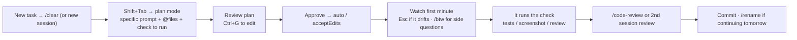

# 4 · Power features & the playbook for using Claude Code optimally

[← 3 · Extensibility & guardrails](03-extensibility-and-guardrails.md) · [Guide index](README.md)

**In one sentence:** most of the difference between an average and an expert Claude Code user is **steering**: interrupting early, keeping context clean, giving it checks to run, and using the right feature for the moment.

Availability varies by version, plan and platform. `/help` shows what *your* build has. Sources: [Commands](https://code.claude.com/docs/en/commands) · [Interactive mode](https://code.claude.com/docs/en/interactive-mode) · [Checkpointing](https://code.claude.com/docs/en/checkpointing) · [Best practices](https://code.claude.com/docs/en/best-practices).

---

## 4.1 `/btw`: a side question that doesn't pollute the conversation

📘 `/btw what was the name of that config file again?`
- Ask a quick question **while Claude is working**. It **doesn't interrupt** the main task.
- It **sees the conversation so far**, but has **no tool access**: no reading files, no commands, no search. It answers only from what's already in context.
- The answer appears in an overlay and **is not added to the conversation history**, so it doesn't fill the context or distract the main task.
- It's cheap while the prompt cache is warm (it reuses the cached conversation).
- In the overlay, **`f` forks** the question into a background subagent *with* tools (when you realize you need it to actually look something up). `c` copies the answer.

| You want to… | Use |
|---|---|
| Recall something already discussed ("which file did we change?") | `/btw` |
| Find something new (read files, search) without derailing the main task | A subagent / `f` from `/btw` |
| Change what the agent is doing | A normal message (or Esc + message) |

---

## 4.2 Context controls: `/context`, `/compact`, `/clear`

| Command | What it does (📘) | Use when (🧠) |
|---|---|---|
| `/context` | Colored grid of what's using the window, with optimization suggestions | Responses feel slower or vaguer; before a big task |
| `/compact [focus]` | Summarizes the conversation to free context; the optional text steers the summary | At a natural milestone ("feature done, now tests"), e.g. `/compact keep the API design decisions and failing test names` |
| `/clear [name]` | Fresh empty conversation; the optional name labels the old one for `/resume` | **Switching to an unrelated task**, or after two failed corrections |
| `/autocompact 500k` | Sets when auto-compaction kicks in | You'd rather compact earlier and keep responses sharp |
| `/rewind` → *Summarize from here* | Summarizes part of the history while keeping the rest | Dropping a long dead-end exploration |

📘 The best-practices guide: after **two failed corrections**, `/clear` and write a better prompt instead of trying a third time. The bad attempts in context keep pulling it back.

---

## 4.3 Undo: checkpoints, `/rewind`, Esc Esc

📘 Claude Code **automatically snapshots code before each prompt** that starts a turn (100 most recent per session).
- Open the rewind menu with **Esc Esc** (on an empty prompt), `/rewind` or `/undo`. Options: *Restore code and conversation* · *Restore conversation* · *Restore code* · *Summarize from here* · *Summarize up to here*.
- ⚠️ **Not restored:** changes made *only* by Bash commands (e.g. a script that rewrote a file, `npm install`), most background-subagent edits, and edits made outside Claude Code. **Checkpoints are session-level undo, not version control. Keep committing to git.**

🧠 **Workflow:** let it try something bold → doesn't work → Esc Esc → *Restore code and conversation* → re-prompt with what you learned. That's cheaper than arguing it back.

---

## 4.4 Steering while it works

| Action | How | Why |
|---|---|---|
| **Stop now** | `Esc` | Keeps the work so far. 📘 Watch the first minute and press Esc the moment it drifts |
| **Add info mid-run** | Just type and send | 📘 Read after the current tool calls finish, within the same turn |
| **Background a long command / agent** | `Ctrl+B` | Keep chatting while tests or builds run. `/tasks` lists them |
| **See everything it did** | `Ctrl+O` (transcript viewer) | Tool inputs and outputs, timestamps, model per message |
| **Toggle the task checklist** | `Ctrl+T` | See the plan's progress |
| **Edit a long prompt in your editor** | `Ctrl+G` | Write a proper spec |
| **Switch model / fast mode** | `Option+P` / `Option+O` (`Alt` on Win/Linux), `/model`, `/fast` | Remember: switching mid-session breaks the cache once |
| **Change effort** | `/effort high` · `ultrathink` in a prompt | Raise for hard turns only |

---

## 4.5 Input superpowers

- **`@path/to/file`**: attach a file (autocomplete). Also attaches MCP resources (`@server:protocol://…`).
- **`!command`**: run a shell command yourself. Its output goes into the conversation for Claude to use (e.g. `!git log --oneline -5`).
- **`/plan <description>`** or **Shift+Tab** → plan mode.
- **Images:** paste with `Ctrl+V` (`Cmd+V` in iTerm2), e.g. screenshots of a bug or a design mockup to match.
- **Multiline:** `Shift+Enter` (most modern terminals; `/terminal-setup` for others) or `Ctrl+J` anywhere.
- **History:** `Ctrl+R` reverse search; `Esc Esc` with text saves a draft; `Ctrl+S` stashes a prompt.
- **Stack skills:** `/review-style /security-check do X` (up to six).

---

## 4.6 Sessions, parallelism and long work

| Feature | 📘 What it does | 🧠 Use it for |
|---|---|---|
| `claude --continue` / `--resume <name>` / `/resume` | Return to a previous session | Multi-day tasks. Run `/rename oauth-migration` first |
| `/clear name` | Start fresh but keep the old session resumable | Switching tasks without losing work |
| **Parallel sessions** | Several Claude Code sessions at once | Writer in one session, independent reviewer in another (📘 *"the easiest independent reviewer"*) |
| **Git worktrees** | Separate working copies (subagents can use `isolation: worktree`) | Parallel features without stepping on each other |
| `/background`, `/fork`, `/subtask` | Detach a session, copy the conversation to a background session, or start a forked subagent | Hand off a long job and keep working |
| `/loop [interval] prompt` | Re-run a prompt periodically while the session is open | "Check CI every 5 min and fix failures" |
| `/goal <condition>` | Keep working across turns until a condition holds | "until all tests in tests/api pass" |
| `/batch` | Split a large change into many units, each in its own worktree/subagent, each opening a PR | Big mechanical migrations |

📘 Background work (`/loop`, goal checks, subagents) **keeps spending tokens**. Watch `/usage`.

---

## 4.7 Built-in commands worth knowing (📘)

| Command | Purpose |
|---|---|
| `/init` | Generate a starter CLAUDE.md for the repo |
| `/memory` | View/edit CLAUDE.md files and auto memory; toggle auto memory |
| `/model`, `/effort`, `/fast` | Model, reasoning depth, speed |
| `/usage` (aliases `/cost`, `/stats`) | Session cost, cache hit rate, plan limits; breakdown by skill/subagent/plugin/MCP |
| `/permissions` | Allow/ask/deny rules + recent auto-mode denials |
| `/hooks`, `/mcp`, `/plugin`, `/agents` | Inspect and manage extensions |
| `/code-review [--fix]` (`/review`) | Correctness review of your diff in a fresh subagent |
| `/security-review` | Vulnerability review of your branch diff |
| `/diff` | Review working-tree changes |
| `/doctor` | Diagnose your setup |
| `/statusline` | Describe a status line (e.g. "model, context %, git branch") and it writes the script |
| `/output-style` | Default, Concise, Explanatory, Learning (adds "Insight" blocks and leaves `TODO(human)` parts for you to write). Great while learning |
| `/sandbox` | Toggle OS-level sandboxing for shell commands |
| `/export` | Save the conversation as text |
| `/add-dir` | Give access to another directory |
| `/insights` | HTML report of your recent usage patterns |

---

## 4.8 The playbook: using Claude Code optimally

The current best-practices guide (📘) is organized around four ideas. Here they are with concrete habits.

### ① Tell Claude what it can't see
- **Specific prompts:** name the file, describe the symptom, say what "fixed" looks like.
  - ❌ "fix the login bug"
  - ✅ "In `auth/session.py`, users are logged out after 5 min instead of 24 h. Expected: `SESSION_TTL` respected. Run `pytest tests/test_session.py`."
- **Give evidence:** paste error output, attach screenshots, pipe logs (`cat error.log | claude -p …`).
- **Brainstorm first** for fuzzy tasks: ask Claude to *interview you* and write a `SPEC.md` before coding.
- **Short CLAUDE.md** (<200 lines). Scope rules with `.claude/rules/` + `paths:`, and put procedures in **skills**.
- **Connect the tools it needs** (CLIs, MCP) so it can check things itself.

### ② Give Claude a check to run
- Tests, a type-checker, a linter, a screenshot next to the mockup, a `/code-review` from a fresh subagent.
- **Ask for evidence:** "show me the command you ran and its output."
- Enforce with a **Stop hook** when it matters ([file 3](03-extensibility-and-guardrails.md#recipes-youll-actually-use)).

### ③ Enforce the rules that can't have exceptions
- Hooks for required steps (format, lint, secrets scan), **deny rules** + **sandbox** for access, and settings scope (user / project / managed) for *who* a rule applies to.

### ④ Let Claude run without you, safely
- `claude -p` in CI, git hooks and shell loops; `--bare` for reproducible scripts; scheduled runs; parallel sessions. Use `dontAsk`/`auto` modes with **narrow allow rules** and budgets.

### A daily workflow that puts it all together

### Cost & speed checklist
- [ ] Pick **model / fast mode at the start**. Don't flip mid-session (cache).
- [ ] `/clear` between unrelated tasks (📘 it "costs nothing").
- [ ] Lower **effort** for routine work; raise it per hard turn (`ultrathink`).
- [ ] `model: haiku` on simple custom subagents; give reviewer subagents read-only tools.
- [ ] Disable unused **MCP servers** (`/mcp`); prefer known CLIs.
- [ ] Filter verbose tool output with a **PreToolUse/PostToolUse hook** (e.g. only failing tests).
- [ ] Check **`/usage`**: cache hit rate, and which skill/subagent/MCP is expensive.

### Anti-patterns (and the fix)
| Anti-pattern | Fix |
|---|---|
| One endless session for everything | `/clear` per task; `/rename` + `/resume` for multi-day work |
| Third correction attempt in a polluted context | Esc Esc → rewind, or `/clear` and write a better prompt |
| "It said it's done" with no evidence | Require the check's command + output; Stop hook |
| Rules in CLAUDE.md you *need* followed | Make them hooks / deny rules |
| Pasting whole files and logs | `@file`, targeted excerpts, or a subagent to dig |
| Subagents for everything "to get better answers" | 📘 Subagents are for parallelism, noisy output and independent review |
| `bypassPermissions` on your laptop | Auto mode + deny rules + sandbox; bypass only in a VM/container |
| Trusting checkpoints as backup | Commit to git; checkpoints miss Bash-only changes |

---

## 4.9 How this maps to the course

| Claude Code feature | Course concept |
|---|---|
| Gather → act → verify loop | Day 3 agent loop |
| Tool names, permissions, `mcp__` tools | Days 2, 8 |
| Explore/Plan subagents, forks, background agents | Day 9 (many readers, one writer) |
| Compaction, `/context`, tool search, caching | Day 5 |
| CLAUDE.md + auto memory + skills | Day 7 (+ progressive disclosure) |
| Hooks, permission rules, sandbox, auto-mode classifier | Day 12 (defense in depth) |
| `/usage`, effort, fast mode, haiku subagents | Day 13 (cost & latency levers) |
| Agent SDK, `claude -p`, GitHub Actions | Days 14–15 |

**Exercise:** set up this course repo for Claude Code. Write a CLAUDE.md (≤60 lines) with the test command, a PostToolUse formatter hook, a deny rule for `.env`, and a `code-reviewer` subagent on Haiku. Then ask it to add a new ShopEase eval case and check that it ran the tests.

[← Back to the guide index](README.md)
