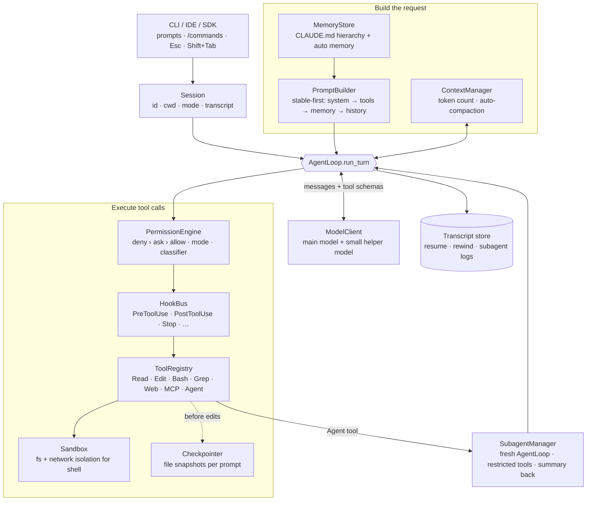

# 5 · Low-level design: the Claude Code harness on one page

[← 4 · Power features & playbook](04-power-features-and-playbook.md) · [Guide index](README.md)

> **What this is:** a *teaching* low-level design, reconstructed from Anthropic's public docs and parts 1–4 of this guide. It shows the components, their interfaces and how one turn flows through them. **It is not Anthropic's source code.** Real internals (prompts, heuristics, the auto-mode classifier) are more complex and not fully public. 📘 = documented behavior · 🧠 = design reasoning.

## Block diagram



## Components

| Component | Responsibility | Key state / interface | Guide |
|---|---|---|---|
| `Session` | One conversation: cwd, permission mode, history | `messages`, `mode`, `id` | [1](01-architecture-models-and-the-loop.md) |
| `AgentLoop` | Think → act → observe until no tool calls; budgets | `run_turn(prompt) -> text` | [1](01-architecture-models-and-the-loop.md#13-the-loop-step-by-step) |
| `ModelClient` | Call the main model; a small model for background chores | `generate(system, messages, tools)` | [1](01-architecture-models-and-the-loop.md#12-which-models-run-and-for-what) |
| `PromptBuilder` | Assemble the system prompt **stable-first** (cache-friendly) | `build(memory, tools, skills)` | [2](02-context-memory-and-prompts.md#24-prompt-caching-why-a-stable-prefix-matters) |
| `MemoryStore` | Load CLAUDE.md files (root → cwd) + auto memory | `load(project) -> str` | [2](02-context-memory-and-prompts.md#25-memory-how-knowledge-survives-between-sessions) |
| `ContextManager` | Track tokens; compact old history into a summary | `maybe_compact(messages)` | [2](02-context-memory-and-prompts.md#23-compaction-in-detail) |
| `ToolRegistry` | Built-in + MCP tools; MCP definitions deferred until needed | `visible()`, `get(name)`, `load_deferred()` | [1](01-architecture-models-and-the-loop.md#14-the-tools-the-agents-hands) |
| `PermissionEngine` | deny › ask › allow rules, then the mode (default / acceptEdits / plan / auto / bypass) | `decide(call, tool) -> allow/deny` | [3](03-extensibility-and-guardrails.md#34-guardrails-permission-modes) |
| `HookBus` | Run user hooks at fixed events; can block or add context | `emit(event, payload) -> HookResult` | [3](03-extensibility-and-guardrails.md#31-hooks-your-code-runs-at-fixed-points-in-the-loop) |
| `Checkpointer` | Snapshot files before edits; restore on rewind | `before_edit(path)`, `rewind()` | [4](04-power-features-and-playbook.md#43-undo-checkpoints-rewind-esc-esc) |
| `SubagentManager` | Run a side task in a **fresh** loop with limited tools; return a summary | `spawn(task, allowed_tools) -> str` | [1](01-architecture-models-and-the-loop.md#19-subagents-when-it-fires-which-agent-and-why) |
| `Sandbox` | OS-level isolation for shell commands | wraps `Bash` | [3](03-extensibility-and-guardrails.md#36-guardrails-the-sandbox) |

## One turn, step by step
1. `UserPromptSubmit` hooks run. They can block the prompt or add context.
2. `Checkpointer` starts a new checkpoint for this prompt. 📘 Each prompt creates one.
3. `PromptBuilder` provides the (cached, stable) system prompt: rules + tool list + CLAUDE.md + auto memory.
4. **Loop:** `ContextManager.maybe_compact()` → `ModelClient.generate()` → append the reply.
   - No tool calls → run `Stop` hooks (they may say "not done yet") → return the answer.
   - Tool calls → for each call: `PermissionEngine.decide` → `PreToolUse` hooks → snapshot file if it's an edit → run the tool → `PostToolUse` hooks. 📘 **Read-only tools run in parallel; state-changing tools run one at a time.**
   - Append **all** results as one message, then loop.
5. Persist the transcript so `--resume` and `/rewind` work.

## High-level Python

```python
"""Teaching LLD of an agent harness in the style of Claude Code. Runnable: `python lld.py`."""
from __future__ import annotations

import fnmatch
from concurrent.futures import ThreadPoolExecutor
from dataclasses import dataclass, field
from enum import Enum
from typing import Callable, Protocol

# ── Data model ────────────────────────────────────────────────────────────────
@dataclass
class ToolCall:
    id: str
    name: str
    args: dict

@dataclass
class ToolResult:
    call_id: str
    output: str
    is_error: bool = False

@dataclass
class ModelReply:
    text: str = ""
    tool_calls: list[ToolCall] = field(default_factory=list)

@dataclass
class Message:
    role: str                      # "user" | "assistant"
    content: object                # str | ModelReply | list[ToolResult]

class Model(Protocol):             # ModelClient: Claude in the real thing; anything here
    def generate(self, system: str, messages: list[Message], tools: list["Tool"]) -> ModelReply: ...

# ── Tools ─────────────────────────────────────────────────────────────────────
@dataclass
class Tool:
    name: str
    description: str
    run: Callable[[dict], str]
    read_only: bool = False        # read-only tools may run in parallel
    primary_arg: str = ""          # what permission rules match against (path, command, url)
    needs_permission: bool = True  # e.g. Agent: spawning needs no approval; the subagent's own calls do

class ToolRegistry:
    def __init__(self):
        self.tools: dict[str, Tool] = {}
        self.deferred: dict[str, Tool] = {}          # MCP tools: only names in context until loaded

    def register(self, tool: Tool, deferred: bool = False):
        (self.deferred if deferred else self.tools)[tool.name] = tool

    def load_deferred(self, name: str):              # what ToolSearch does
        self.tools[name] = self.deferred.pop(name)

    def visible(self) -> list[Tool]:
        return list(self.tools.values())

    def is_read_only(self, name: str) -> bool:
        return name in self.tools and self.tools[name].read_only

    def subset(self, names: set[str]) -> "ToolRegistry":
        r = ToolRegistry(); r.tools = {n: t for n, t in self.tools.items() if n in names}; return r

# ── Permissions: deny › ask › allow, then the mode ────────────────────────────
class Mode(Enum):
    DEFAULT, ACCEPT_EDITS, PLAN, AUTO, BYPASS = "default", "acceptEdits", "plan", "auto", "bypassPermissions"

EDIT_TOOLS = {"Edit", "Write"}

@dataclass
class PermissionEngine:
    mode: Mode
    allow: list[str] = field(default_factory=list)   # e.g. "Bash(pytest*)"
    ask: list[str] = field(default_factory=list)
    deny: list[str] = field(default_factory=list)    # e.g. "Read(.env)"
    ask_user: Callable[[ToolCall], bool] = lambda call: False
    classifier: Callable[[ToolCall], bool] = lambda call: True   # auto mode's risk check

    @staticmethod
    def _match(rule: str, call: ToolCall, tool: Tool) -> bool:
        name, _, spec = rule.partition("(")
        if name != call.name:
            return False
        return not spec or fnmatch.fnmatch(str(call.args.get(tool.primary_arg, "")), spec.rstrip(")"))

    def decide(self, call: ToolCall, tool: Tool) -> tuple[bool, str]:
        if any(self._match(r, call, tool) for r in self.deny):
            return False, "denied by rule"                     # 📘 deny wins in every mode
        if any(self._match(r, call, tool) for r in self.ask):
            return self.ask_user(call), "asked user"
        if any(self._match(r, call, tool) for r in self.allow) or tool.read_only or not tool.needs_permission:
            return True, "allowed"
        if self.mode is Mode.PLAN:
            return False, "plan mode: no edits until the plan is approved"
        if self.mode is Mode.BYPASS or (self.mode is Mode.ACCEPT_EDITS and call.name in EDIT_TOOLS):
            return True, f"allowed by mode {self.mode.value}"
        if self.mode is Mode.AUTO:
            return self.classifier(call), "auto-mode classifier"
        return self.ask_user(call), "asked user"

# ── Hooks: deterministic code at fixed events ─────────────────────────────────
@dataclass
class HookResult:
    block: bool = False            # ≈ exit code 2
    reason: str = ""
    context: str = ""              # ≈ additionalContext / stdout fed to the model

class HookBus:
    def __init__(self):
        self.handlers: list[tuple[str, str, Callable[[dict], HookResult]]] = []

    def on(self, event: str, matcher: str = "*"):
        def deco(fn): self.handlers.append((event, matcher, fn)); return fn
        return deco

    def emit(self, event: str, payload: dict) -> HookResult:
        out = HookResult()
        for ev, matcher, fn in self.handlers:
            if ev == event and fnmatch.fnmatch(payload.get("tool_name", ""), matcher):
                r = fn(payload)
                out.block, out.reason = out.block or r.block, r.reason or out.reason
                out.context += r.context
        return out

# ── Memory, prompt, context, checkpoints ──────────────────────────────────────
class MemoryStore:
    def __init__(self, files: dict[str, str]): self.files = files     # path → content
    def load(self) -> str:                                            # root → cwd, concatenated
        order = ["~/.claude/CLAUDE.md", "CLAUDE.md", "CLAUDE.local.md", "memory/MEMORY.md"]
        return "\n".join(self.files[p] for p in order if p in self.files)

class PromptBuilder:
    def build(self, memory: str, tools: list[Tool]) -> str:           # stable parts first → cache hits
        tool_list = "\n".join(f"- {t.name}: {t.description}" for t in tools)
        return f"## Rules\nGather context, act, verify.\n## Tools\n{tool_list}\n## Project memory\n{memory}"

class ContextManager:
    def __init__(self, limit_tokens: int, summarize: Callable[[list[Message]], str], keep_recent: int = 6):
        self.limit, self.summarize, self.keep = limit_tokens, summarize, keep_recent

    def tokens(self, messages: list[Message]) -> int:
        return sum(len(str(m.content)) for m in messages) // 4   # rough estimate

    def maybe_compact(self, messages: list[Message]) -> list[Message]:
        if self.tokens(messages) < self.limit or len(messages) <= self.keep:
            return messages
        cut = len(messages) - self.keep
        while cut > 0 and not isinstance(messages[cut].content, str):  # never split a call from its result
            cut -= 1
        return [Message("user", "[Summary] " + self.summarize(messages[:cut]))] + messages[cut:]

class Checkpointer:
    def __init__(self, fs: dict[str, str]): self.fs, self.stack = fs, []
    def new_checkpoint(self): self.stack.append({})
    def before_edit(self, path: str): self.stack[-1].setdefault(path, self.fs.get(path))
    def rewind(self):                                               # 📘 restores files Claude edited
        for path, old in self.stack.pop().items():
            self.fs.pop(path, None) if old is None else self.fs.__setitem__(path, old)

# ── The loop ──────────────────────────────────────────────────────────────────
class AgentLoop:
    def __init__(self, model: Model, tools: ToolRegistry, perms: PermissionEngine, hooks: HookBus,
                 memory: MemoryStore, context: ContextManager, checkpoints: Checkpointer, max_steps: int = 30):
        self.model, self.tools, self.perms, self.hooks = model, tools, perms, hooks
        self.context, self.checkpoints, self.max_steps = context, checkpoints, max_steps
        self.system = PromptBuilder().build(memory.load(), tools.visible())   # built once per session
        self.messages: list[Message] = []

    def run_turn(self, prompt: str) -> str:
        pre = self.hooks.emit("UserPromptSubmit", {"prompt": prompt})
        if pre.block:
            return f"[prompt blocked: {pre.reason}]"
        self.checkpoints.new_checkpoint()
        self.messages.append(Message("user", prompt + pre.context))
        for _ in range(self.max_steps):
            self.messages = self.context.maybe_compact(self.messages)
            reply = self.model.generate(self.system, self.messages, self.tools.visible())
            self.messages.append(Message("assistant", reply))
            if not reply.tool_calls:
                stop = self.hooks.emit("Stop", {"text": reply.text})
                if not stop.block:
                    return reply.text
                self.messages.append(Message("user", f"[Stop hook] {stop.reason}"))  # keep going
                continue
            self.messages.append(Message("user", self._execute(reply.tool_calls)))
        return "[stopped: step limit]"

    def _execute(self, calls: list[ToolCall]) -> list[ToolResult]:
        reads = [c for c in calls if self.tools.is_read_only(c.name)]
        with ThreadPoolExecutor() as pool:                         # 📘 read-only in parallel
            done = dict(zip([c.id for c in reads], pool.map(self._run_one, reads)))
        for c in calls:                                            # writes one at a time, in order
            if c.id not in done:
                done[c.id] = self._run_one(c)
        return [done[c.id] for c in calls]                        # ALL results in one message

    def _run_one(self, call: ToolCall) -> ToolResult:
        tool = self.tools.tools.get(call.name)
        if not tool:
            return ToolResult(call.id, f"Error: unknown tool {call.name}", True)
        ok, why = self.perms.decide(call, tool)
        if not ok:
            return ToolResult(call.id, f"Permission denied ({why})", True)
        payload = {"tool_name": call.name, "tool_input": call.args}
        pre = self.hooks.emit("PreToolUse", payload)
        if pre.block:
            return ToolResult(call.id, f"Blocked by hook: {pre.reason}", True)
        if call.name in EDIT_TOOLS:
            self.checkpoints.before_edit(call.args["path"])
        try:
            out = tool.run(call.args)
        except Exception as e:                                     # errors go back to the model
            return ToolResult(call.id, f"Error: {e}", True)
        post = self.hooks.emit("PostToolUse", payload | {"tool_response": out})
        return ToolResult(call.id, out + post.context)

# ── Subagents: a fresh loop with restricted tools, summary back ───────────────
class SubagentManager:
    def __init__(self, make_loop: Callable[[ToolRegistry], AgentLoop], registry: ToolRegistry):
        self.make_loop, self.registry = make_loop, registry

    def spawn(self, task: str, allowed: set[str]) -> str:
        sub = self.make_loop(self.registry.subset(allowed))      # new context: sees only `task`
        return sub.run_turn(task + "\nReturn a short summary.")

# ── Demo with a scripted model (no API needed) ────────────────────────────────
class ScriptedModel:
    def __init__(self, script: list[ModelReply]): self.script = script
    def generate(self, system, messages, tools) -> ModelReply: return self.script.pop(0)

if __name__ == "__main__":
    fs = {"auth.py": "def login(u, p):\n    return u == p\n", ".env": "SECRET=1"}
    reg = ToolRegistry()
    reg.register(Tool("Read", "read a file", lambda a: fs[a["path"]], read_only=True, primary_arg="path"))
    reg.register(Tool("Grep", "search files", lambda a: "\n".join(p for p, t in fs.items() if a["pattern"] in t),
                      read_only=True, primary_arg="pattern"))
    reg.register(Tool("Edit", "replace text", lambda a: fs.__setitem__(a["path"], fs[a["path"]].replace(
        a["old"], a["new"])) or "edited", primary_arg="path"))
    reg.register(Tool("Bash", "run a command", lambda a: "2 passed", primary_arg="command"))

    hooks = HookBus()
    hooks.on("PreToolUse", "Bash")(lambda p: HookResult(block="rm -rf" in p["tool_input"]["command"], reason="dangerous"))
    hooks.on("PostToolUse", "Edit")(lambda p: HookResult(context=" (formatted by hook)"))
    perms = PermissionEngine(Mode.ACCEPT_EDITS, allow=["Bash(pytest*)"], deny=["Read(.env)"])
    memory = MemoryStore({"CLAUDE.md": "Tests: `pytest -q`"})
    ctx = ContextManager(limit_tokens=50_000, summarize=lambda ms: f"{len(ms)} earlier messages")
    cps = Checkpointer(fs)

    sub_model = ScriptedModel([ModelReply(tool_calls=[ToolCall("s1", "Grep", {"pattern": "def login"})]),
                               ModelReply(text="login() is in auth.py and compares u == p (insecure).")])
    subagents = SubagentManager(lambda r: AgentLoop(sub_model, r, perms, hooks, memory, ctx, cps), reg)
    reg.register(Tool("Agent", "delegate a side task", lambda a: subagents.spawn(a["task"], {"Grep", "Read"}),
                      needs_permission=False))

    main_model = ScriptedModel([
        ModelReply(tool_calls=[ToolCall("1", "Agent", {"task": "Where is login handled?"}),
                               ToolCall("2", "Read", {"path": ".env"})]),
        ModelReply(tool_calls=[ToolCall("3", "Edit", {"path": "auth.py", "old": "u == p", "new": "check_hash(u, p)"})]),
        ModelReply(tool_calls=[ToolCall("4", "Bash", {"command": "pytest -q"})]),
        ModelReply(text="Fixed login to use check_hash; tests pass."),
    ])
    agent = AgentLoop(main_model, reg, perms, hooks, memory, ctx, cps)
    print(agent.run_turn("Fix the insecure login and run the tests."))
    for m in agent.messages:
        if isinstance(m.content, list):
            print("  results:", [(r.call_id, r.output[:60], r.is_error) for r in m.content])
    cps.rewind()
    print("after rewind:", fs["auth.py"].strip())
```

**What the demo shows:** the `Agent` tool runs a subagent in a fresh context and gets back a summary. `Read(.env)` is **denied by rule**. The edit is auto-approved by `acceptEdits` and a **PostToolUse hook** adds context. `pytest` is allowed by an allow rule. The loop stops when the model answers without tool calls. `rewind()` restores `auth.py`.

## Design notes (why it looks like this)
- 🧠 **One loop, many plug-ins.** Intelligence lives in the model. The harness supplies tools, context and control points, so new capabilities are new tools, hooks or MCP servers, not new control flow.
- 📘 **Guidance vs enforcement.** CLAUDE.md shapes behavior; `PermissionEngine` and `HookBus` *enforce* it. Deny rules win in every mode.
- 📘 **Stable prefix.** The system prompt is built once per session, so prompt caching hits. Switching model or MCP servers mid-session breaks the cache.
- 📘 **Concurrency split.** Read-only tools run in parallel; edits and shell commands run sequentially, so state changes stay ordered and reviewable.
- 📘 **Context isolation.** Subagents get a fresh context and restricted tools, and only their summary returns. Compaction never splits a tool call from its result.
- **Extending it:** add a `Tool` to the registry (or an MCP server whose tools load deferred) · `hooks.on("PreToolUse", "Bash")` for policy · a rule string in `allow`/`deny` · a new subagent = `spawn(task, allowed_tools)`.

[← Guide index](README.md) · Related: [case study 03](../03-claude-code-agent-loop.md) · course [Day 3](../../week-1/theory/day-03-agent-loop-and-planning.md) (the loop you built) and [Day 12](../../week-3/theory/day-12-safety-and-guardrails.md) (guardrails)
