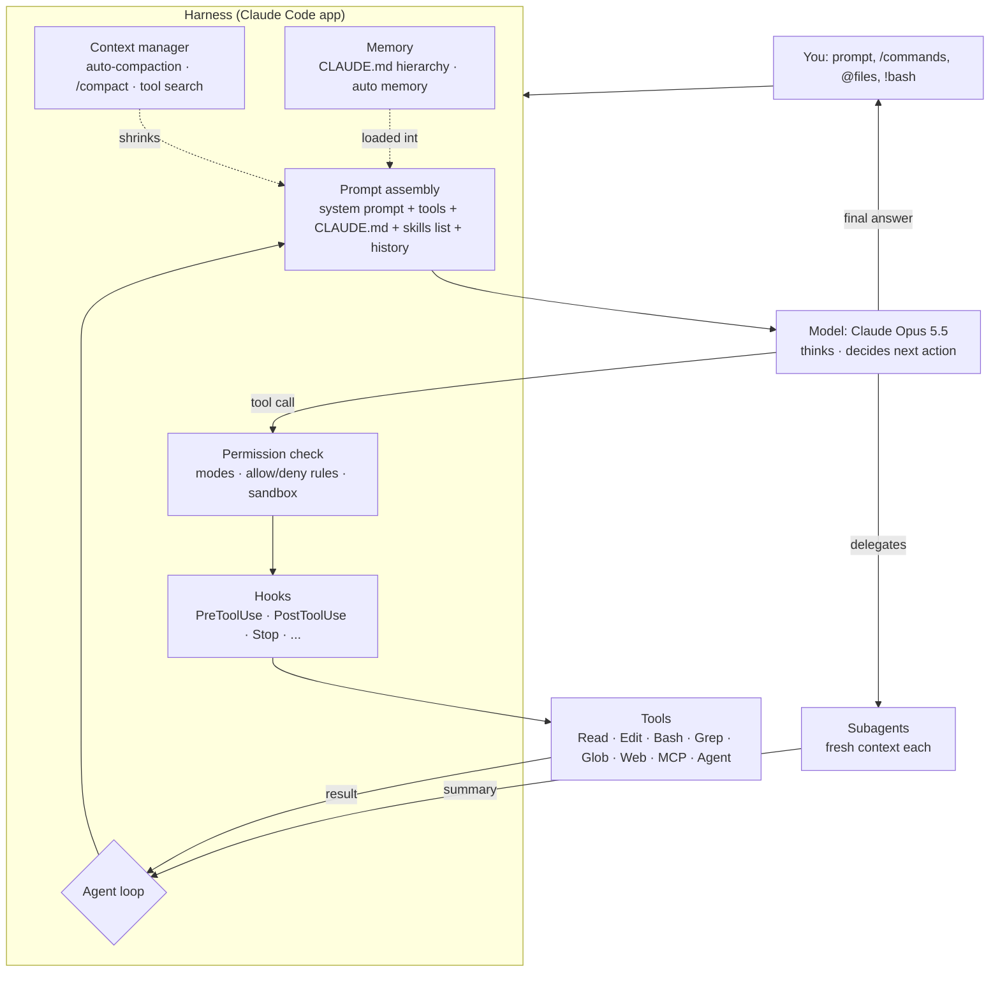

# Claude Code, inside out: a deep guide (Claude Opus 5.5)

> **Goal:** understand every moving part of Claude Code (the model, the harness, the loop, tools, subagents, context, memory, hooks, MCP, guardrails and power features) well enough to use it *optimally* and to design your own agents the same way.

## The one-picture mental model

**Claude Code = a model + a harness.**
- The **model** (Claude Opus 5.5 by default for this guide) is the "brain". It only reads text and writes text, including structured *tool calls*.
- The **harness** is everything else. It builds the prompt, defines the tools, runs them on your machine, asks permission, stores memory, manages the context window, fires hooks, connects MCP servers and starts subagents.

Every behavior you see (searching before editing, running the tests again, asking before `rm`, delegating to an "Explore" agent) is one of these parts at work.

## How to read this guide

| # | File | Read it to understand |
|---|---|---|
| 1 | [Architecture, models & the agent loop](01-architecture-models-and-the-loop.md) | Which models run and why; the loop step by step; tool calling; how it picks commands/files; why it re-verifies; when it searches the web; how it decides what to test; when and why subagents fire |
| 2 | [Context, memory & prompt management](02-context-memory-and-prompts.md) | What fills the context window; compaction; caching; the CLAUDE.md hierarchy and auto memory; skills; writing great project memory |
| 3 | [Extensibility & guardrails](03-extensibility-and-guardrails.md) | Hooks, MCP, skills, slash commands, plugins, custom subagents; permission modes, rules, sandboxing, checkpoints; headless & SDK |
| 4 | [Power features & the playbook](04-power-features-and-playbook.md) | `/btw`, `/compact`, `/context`, `/rewind`, plan mode, background tasks, worktrees, shortcuts, and a workflow playbook for using it optimally |
| 5 | [Low-level design (one page)](05-low-level-design.md) | Block diagram + component interfaces + ~250 lines of runnable Python modelling the whole harness: loop, permissions, hooks, context, checkpoints, subagents |

## Legend: how sure is each statement?
- 📘 **Documented:** stated in Anthropic's docs or engineering posts (linked).
- 🧠 **Explained:** reasoning about *why* the agent behaves a certain way, based on how LLM agents work and on observing the harness. Useful mental models, but not official guarantees. Anthropic doesn't publish every internal heuristic or prompt.

Features change quickly. When a command or flag behaves differently from what's written here, run `/help`, or check the docs linked in each section.

## Prerequisites from this course
Day 3 (agent loop), Day 5 (context & caching), Day 7 (memory), Day 8 (MCP), Day 9 (subagents), Day 12 (guardrails). Short overview: [case study 03](../03-claude-code-agent-loop.md).
