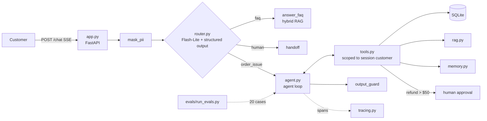

# 🛍️ ShopEase Support Agent: the course capstone

A customer-support agent for **ShopEase**, a fictional online store. You build it piece by piece across the 15 days. This folder holds a **working reference implementation**, so you can compare your version with it, run its evals and break it on purpose.



## Run it

```bash
# from the repo root (Codespaces does the first line for you)
pip install -r requirements.txt && pip install -e . && python -m shopease.data

python -m pytest                                   # 16 tests, no API key needed (scripted fake Gemini client)
cd projects/shopease-support-agent
python evals/run_evals.py                          # 20 eval cases against Gemini (needs GEMINI_API_KEY)
uvicorn app:app --port 8000                        # streaming API
```

Try it in Python:

```python
from shopease.agent import SupportAgent
agent = SupportAgent("C001", approve=lambda tool, details: input(f"Approve {details}? y/n ") == "y")
print(agent.chat("My smart watch O2001 stopped working, can I get a refund?").text)
print(agent.tracker.summary())
```

## Code map

| File | What it does | Built on day |
|---|---|---|
| `shopease/data.py` | Deterministic SQLite data + policy docs, including hand-written edge-case orders | 1 |
| `shopease/tools.py` | 8 task-shaped tools, strict schemas, ownership checks in SQL, idempotent refunds, approval gate | 2, 12 |
| `shopease/agent.py` | Gemini agent loop: stable system instruction (implicit caching), thinking level, budgets, repeat detection, streaming events, output guard | 3, 5, 13 |
| `shopease/router.py` | Triage (faq / order_issue / human) with a keyword fallback; FAQ answers via RAG | 4, 6 |
| `shopease/rag.py` | Section chunking, BM25 + fastembed vectors, RRF fusion, optional cross-encoder rerank | 6 |
| `shopease/memory.py` | Per-customer facts, write policy (no PII, entitlement claims flagged), forget() | 7 |
| `shopease/mcp_server.py` | Order tools as an MCP server (`mcp` 2.x `MCPServer`), customer id set by the host | 8 |
| `shopease/guardrails.py` | PII masking, untrusted-content wrapper, injection heuristic, output guard | 12 |
| `shopease/tracing.py` | Minimal span tracer → JSONL (swap for OpenTelemetry/Langfuse) | 13 |
| `evals/` | 20 cases (8 critical), code graders, optional LLM judge, pass^k, report, CI exit code | 11 |
| `app.py` | FastAPI Server-Sent Events endpoint | 15 |
| `tests/` | Unit + integration tests with a scripted fake Gemini client | all |

## Milestones (build your own version alongside the course)

| Day | Milestone | Done when… |
|---|---|---|
| 1 | Data + cost tracker | `python -m shopease.data` works; you can print $ per call |
| 2 | Tools | Each tool works when called directly; errors are actionable |
| 3 | Agent loop | 10 realistic messages handled; transcripts saved |
| 4 | Router | ≥50% of synthetic traffic avoids the expensive agent |
| 5 | Caching + trimming | >70% of input tokens served from cache in a 10-turn chat |
| 6 | Policy RAG | recall@3 measured; agent cites sources |
| 7 | Memory | Preferences reused next session; poisoning attempt stored as a claim |
| 8 | MCP | Agent discovers its tools from `mcp_server.py` |
| 9 | Escalation subagent | Complex complaints get a structured, read-only investigation |
| 10 | Ops analytics | Managers' data questions answered by a read-only code agent |
| 11 | Evals | `run_evals.py` gates changes (exit code), pass^3 reported |
| 12 | Safety | All critical security cases pass; approval gate on refunds > $50 |
| 13 | Production | Traces, retries, cost/latency in the report |
| 14 | Frameworks | Same core rebuilt in LangGraph + one more; same evals |
| 15 | Ship | Streaming API + final report + one-page design doc |

## Business rules (encoded in code, tested in `tests/test_tools.py`)
- Returns: within **30 days** of delivery (day 30 is still OK). Already-returned orders can't be refunded.
- Lost shipments: in transit **> 10 days** → replacement or refund.
- Processing orders: cancel instead of refund.
- Refunds **> $50** need human approval → `pending_approval` until a person approves.
- "Today" is fixed at **2026-11-20** (`SHOPEASE_TODAY`) so the edge cases stay reproducible.

| Edge-case order | Customer | Situation |
|---|---|---|
| O2001 | C001 | $199 smart watch, delivered 12 days ago → eligible, needs approval |
| O2002 | C001 | Delivered 36 days ago → outside window |
| O2003 | C002 | Shipped 18 days ago, not delivered → lost |
| O2004 | C003 | Delivered exactly 30 days ago → eligible |
| O2005 | C003 | Processing → cancel |
| O2006 | C002 | Already returned |
| O2007 | C004 | $35, delivered 6 days ago → eligible, no approval needed |
