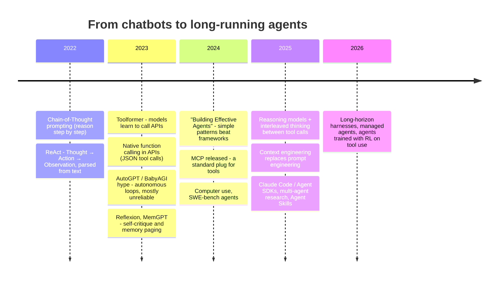
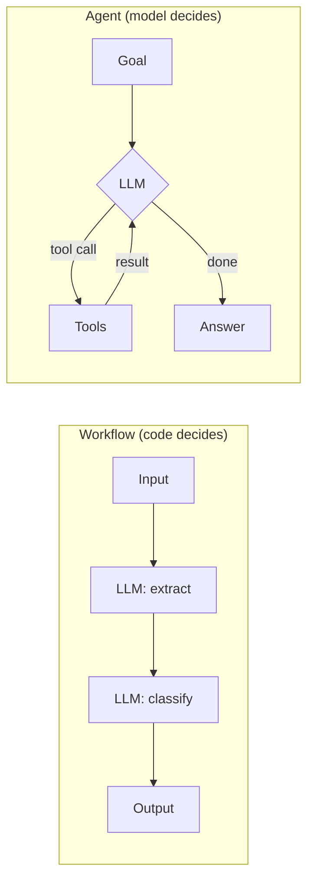

[Week 1 overview](../README.md) · [▶️ Practice notebook](../practice/day-01-tokens-and-cost.ipynb) · [Day 2 →](../../week-1/theory/day-02-tool-calling.md)

## Day 1 — What an agent really is, and how we got here

⏱ 60 min theory · 60 min capstone setup · 15 min review

**Goals:** understand an LLM from the agent builder's point of view (tokens, context, cost); know the history of agents; be able to decide *workflow vs agent*.


> 🛠 **Before you start:** follow [SETUP.md](../../SETUP.md) (GitHub Codespaces, API key, free-tier tips). In this repo the Day 1 capstone data is generated for you by `python -m shopease.data` (code: [shopease/data.py](../../projects/shopease-support-agent/shopease/data.py)). The snippet below shows the idea.

### 🎥 Watch first (short videos)
- 🎥 [What are AI Agents?](https://www.youtube.com/watch?v=F8NKVhkZZWI): *IBM Technology (Maya Murad)*. clear 101 on agents vs compound AI systems
- 🎥 [How We Build Effective Agents](https://www.youtube.com/watch?v=D7_ipDqhtwk): *Barry Zhang, Anthropic (AI Engineer Summit)*. ~15 min · when NOT to build agents
- 🎥 [Tips for building AI agents](https://www.youtube.com/watch?v=LP5OCa20Zpg): *Anthropic (Barry Zhang, Erik Schluntz, Alex Albert)*. ~18 min · workflows vs agents, common pitfalls

> Durations are approximate. "Community explainer" means an independent creator; the written links in each section are the primary sources.

### 1.1 The LLM from an agent builder's view

**Intuition.** An LLM is a function: `text in → next token out`, repeated. It has **no memory between calls**. Every API call you make sends the *whole* conversation again. That single fact explains most of agent engineering:

- "Memory" = what you choose to put back into the prompt.
- "Cost" = how many tokens you resend, times how many loop steps you run.
- "Context window" = the maximum the model can read in one call (Opus 5.5: 1M tokens).

**The math you'll use daily: cost of an agent run.**

Say the agent runs `n` steps and each step adds `a` tokens to the history (tool call + result). The prompt at step *k* is roughly `P₀ + k·a` tokens, where `P₀` is the system prompt + tools + question. Total input tokens:

$$\text{Input}_{total} = \sum_{k=0}^{n-1}(P_0 + k\,a) = nP_0 + a\frac{n(n-1)}{2}$$

👉 **Input cost grows ~quadratically with steps.** A 30-step agent doesn't cost 3× a 10-step one. It costs ~5–9×. This is why caching (Day 5) and context trimming matter so much.

```python
def agent_cost(n_steps, p0=3000, add_per_step=800, out_per_step=300, in_price=4.0, out_price=20.0):
    """Estimate $ for an agent run. Prices are per 1M tokens (Opus 5.5 list prices)."""
    inp = n_steps * p0 + add_per_step * n_steps * (n_steps - 1) / 2
    out = n_steps * out_per_step
    return (inp * in_price + out * out_price) / 1e6

for n in (5, 10, 30):
    print(f"{n:>2} steps: ${agent_cost(n):.3f}")
# 5 steps: $0.122 · 10 steps: $0.324 · 30 steps: $1.932  ← 6× the steps, 16× the cost!
```

**Practical lessons**
- Always log `response.usage` (input, output, cache tokens). You'll build a tracker today.
- Output tokens cost ~5× input tokens. Verbose models cost more, and "think less" settings (effort) help.
- Tokens ≈ ¾ of an English word. Code and non-English text use more tokens per word.

📖 Deep dive: 🎥⭐ [Karpathy — Intro to Large Language Models (1h)](https://www.youtube.com/watch?v=zjkBMFhNj_g) · 🎥 [Karpathy — Software Is Changing (Again)](https://www.youtube.com/watch?v=LCEmiRjPEtQ) (Software 3.0, building *for* agents)

### 1.2 How agents evolved (2022 → today)



**What changed and why it matters:**

| Era | Model ability | Scaffolding needed | Lesson |
|---|---|---|---|
| ReAct-era (2022–23) | Weak planning, text-parsed actions | Heavy: parsers, retry-on-format-error, fixed plans | Scaffolding made up for weak models |
| Function-calling era (2023–24) | Reliable JSON tool calls | Medium: workflows, routers | Structure moved into the API |
| Reasoning era (2025+) | Plans, self-corrects, thinks between tool calls | Light: **a loop + good tools + good context** | "Give the model tools and get out of the way" |

**Key insight:** each time models improved, the best architectures got **simpler**. Over-engineered frameworks from 2023 often perform *worse* today than a 50-line loop. Keep this in mind whenever you see a complex agent framework.

📖 Deep dive: 📄 [Chain-of-Thought (Wei et al., 2022)](https://arxiv.org/abs/2201.11903) · 📄 [ReAct (Yao et al., 2022)](https://arxiv.org/abs/2210.03629) · 📄 [Toolformer (2023)](https://arxiv.org/abs/2302.04761) · ⭐ [Lilian Weng — LLM Powered Autonomous Agents (2023 classic: planning + memory + tools)](https://lilianweng.github.io/posts/2023-06-23-agent/)

### 1.3 Workflows vs agents: the most important design decision

**Intuition.** A **workflow** is a recipe: *your code* decides the steps. An **agent** is a chef: *the model* decides the steps. Recipes are cheap, predictable and testable. Chefs handle surprises.



**Decision checklist (from Anthropic's guidance).** Build an agent only if all of these are true:
1. **Complex:** the steps can't be fully listed in advance.
2. **Valuable:** the result is worth the extra cost and latency.
3. **Viable:** the model is actually good at this kind of task.
4. **Errors are recoverable:** mistakes can be caught (tests, review, undo).

Otherwise use a single call or a workflow.

**Reliability math: why fewer steps win.** If each step succeeds with probability *p*, an *n*-step chain succeeds with probability:

$$P(\text{success}) = p^n \qquad 0.95^{10} \approx 0.60, \quad 0.95^{30} \approx 0.21, \quad 0.99^{30} \approx 0.74$$

👉 Long autonomous chains are fragile *unless* the agent can **observe errors and recover** (run the tests, see the failure, fix it). Recovery is what breaks the `p^n` curse, and it's why environment feedback is the core of every good agent.

| | Workflow | Agent |
|---|---|---|
| Predictability | ✅ High | ⚠️ Varies run to run |
| Cost/latency | ✅ Low, bounded | ❌ Higher, unbounded without limits |
| Handles new situations | ❌ Breaks on unexpected input | ✅ Adapts |
| Testing | ✅ Easy, per step | ⚠️ Needs evals (Day 11) |
| Use for | Known processes: extraction, triage, report generation | Open-ended work: coding, research, complex support cases |

**Practical lessons**
- In industry, most "AI agent" products are **80% workflow + one agentic step** where it's needed.
- Start with the simplest version, measure it, and add autonomy only when the simple version fails.

📖 Deep dive: ⭐ [Anthropic — Building Effective Agents](https://www.anthropic.com/engineering/building-effective-agents) · 🎥⭐ [Barry Zhang (Anthropic) — How We Build Effective Agents (15 min)](https://www.youtube.com/watch?v=D7_ipDqhtwk) · ⭐ [OpenAI — A Practical Guide to Building Agents (PDF)](https://cdn.openai.com/business-guides-and-resources/a-practical-guide-to-building-agents.pdf) · [Chip Huyen — Agents](https://huyenchip.com/2025/01/07/agents.html)

### 🧪 Lab → do it in the practice notebook 1 — "Feel the tokens" (Colab, 20 min)
1. Send the same question with a 100-word system prompt and then a 3,000-word one. Print `response.usage` for both.
2. Run `agent_cost()` for 5/10/30 steps and plot the curve with matplotlib. Notice it isn't linear.
3. Ask the same question 5 times and compare the answers. This is why agents need evals.
4. 🆓 Swap: run step 1 with `free_llm("gemini", ...)` and compare `usage`.

### 🏗 Capstone — Day 1: project setup + synthetic data + cost tracker

```python
import sqlite3, random, json, pathlib
random.seed(7)
root = pathlib.Path("shopease/data"); (root / "policies").mkdir(parents=True, exist_ok=True)

db = sqlite3.connect(root / "shopease.db")
db.executescript("""
DROP TABLE IF EXISTS customers; DROP TABLE IF EXISTS orders;
CREATE TABLE customers(id TEXT PRIMARY KEY, name TEXT, email TEXT, tier TEXT);
CREATE TABLE orders(id TEXT PRIMARY KEY, customer_id TEXT, item TEXT, amount REAL,
                    status TEXT, ordered_on TEXT, delivered_on TEXT);
""")
names = ["Asha Rao", "Ben Clark", "Chen Wei", "Diya Shah", "Eli Moss", "Fatima Noor"]
for i, n in enumerate(names, 1):
    db.execute("INSERT INTO customers VALUES (?,?,?,?)",
               (f"C{i:03}", n, n.split()[0].lower() + "@example.com", random.choice(["standard", "gold"])))
items = [("Wireless earbuds", 49.0), ("Running shoes", 89.0), ("Coffee grinder", 35.0), ("Laptop stand", 29.0), ("Smart watch", 199.0)]
for j in range(1, 31):
    item, price = random.choice(items)
    status = random.choice(["processing", "shipped", "delivered", "delivered", "returned"])
    day = random.randint(1, 28)
    db.execute("INSERT INTO orders VALUES (?,?,?,?,?,?,?)",
               (f"O{1000+j}", f"C{random.randint(1, 6):03}", item, price, status,
                f"2026-10-{day:02}", f"2026-11-{min(day + 5, 28):02}" if status == "delivered" else None))
db.commit()

(root / "policies/returns.md").write_text(
    "# Returns\nItems can be returned within 30 days of delivery. Refunds go to the original payment method in 5-7 business days.\n"
    "Gold members get free return shipping. Opened electronics can be returned only if defective.\n")
(root / "policies/shipping.md").write_text(
    "# Shipping\nStandard shipping takes 3-5 business days, express 1-2. Orders over $50 ship free.\n"
    "If an order is not delivered 10 days after it ships, customers may request a replacement or refund.\n")
(root / "policies/warranty.md").write_text(
    "# Warranty\nElectronics have a 1-year warranty against defects. Smart watches have 2 years.\n"
    "Warranty claims need the order id and a short description of the defect.\n")
```

And a cost tracker, which you will reuse every day:

```python
PRICES = {"claude-opus-5-5": (4.0, 20.0), "claude-haiku-5-5": (0.10, 0.50)}  # $/1M in, out

class CostTracker:
    def __init__(self): self.calls = []
    def add(self, model, usage):
        i, o = PRICES[model]
        cache_read = getattr(usage, "cache_read_input_tokens", 0) or 0
        cache_write = getattr(usage, "cache_creation_input_tokens", 0) or 0
        cost = (usage.input_tokens * i + cache_write * i * 1.25 + cache_read * i * 0.05
                + usage.output_tokens * o) / 1e6
        self.calls.append(cost)
        return cost
    def total(self): return sum(self.calls)

tracker = CostTracker()
```

> Cache multipliers (≈1.25× write, read = $0.20/MTok on Opus 5.5 ≈ 0.05×) are explained on Day 5. Always check the current pricing page.

### ✅ Checkpoint
1. Why does an agent's input cost grow faster than linearly with steps?
2. Give one task where you'd use a workflow and one where you'd use an agent. Justify each with the 4-point checklist.
3. Per-step accuracy is 0.97. What's the success rate of a 20-step chain with no recovery?
4. Why did agent architectures get *simpler* as models improved?

---

**Next:** open the [practice notebook](../practice/day-01-tokens-and-cost.ipynb) · capstone milestone in [projects/shopease-support-agent](../../projects/shopease-support-agent/README.md#milestones-build-your-own-version-alongside-the-course)

[Week 1 overview](../README.md) · [▶️ Practice notebook](../practice/day-01-tokens-and-cost.ipynb) · [Day 2 →](../../week-1/theory/day-02-tool-calling.md)
