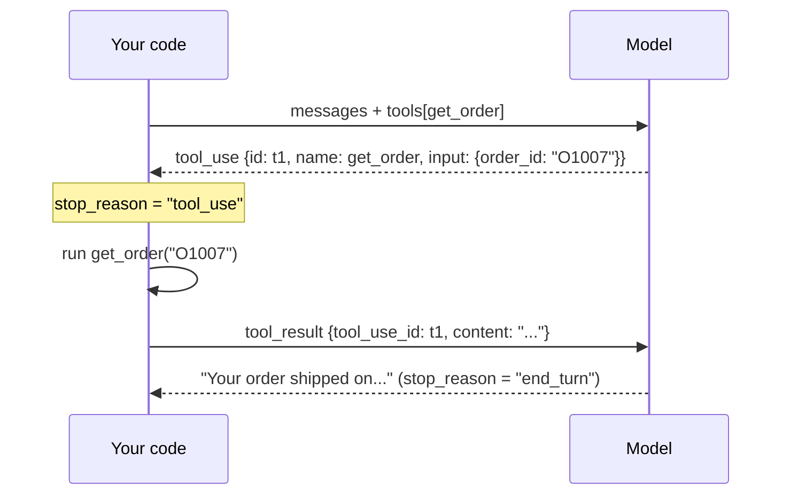

[← Day 1](../../week-1/theory/day-01-what-is-an-agent.md) · [Week 1 overview](../README.md) · [▶️ Practice notebook](../practice/day-02-tool-calling.ipynb) · [Day 3 →](../../week-1/theory/day-03-agent-loop-and-planning.md)

## Day 2 — Tool calling & structured outputs (the agent's hands)

⏱ 60 min theory · 30 min lab · 60 min capstone

**Goals:** master the tool-call protocol, strict schemas, parallel calls and error handling; learn to *design* tools (the agent–computer interface).


### 🎥 Watch first (short videos)
- 🎥 [Tool Calling Explained: Turn Your LLM into an AI Agent](https://www.youtube.com/watch?v=KJf7SqPCRXg): *community explainer*. the request → run → result cycle
- 🎥 [How LLM Tool Calling Works](https://www.youtube.com/watch?v=QiRdYCNXAxk): *community explainer*. short refresher on the mechanics

> Durations are approximate. "Community explainer" means an independent creator; the written links in each section are the primary sources.

### 2.1 The protocol, precisely

**Intuition.** A tool call is a *request form* the model fills in. Your program reads the form, does the work and sends back a *receipt* (`tool_result`) with the matching `tool_use_id`.



**Rules that trip everyone up:**
1. Append the assistant's reply **exactly as received** (`response.content`). It may contain thinking blocks that must be passed back.
2. Every `tool_use` needs a `tool_result` with the same id, sent in the **next user message**.
3. If the model makes several tool calls, return **all results in one message**.
4. On failure, return the error text with `is_error: True`. Never drop a result.

📖 Deep dive: 📘⭐ [Claude docs — Tool use overview](https://platform.claude.com/docs/en/agents-and-tools/tool-use/overview) · 📘 [Gemini — OpenAI-compatible function calling](https://ai.google.dev/gemini-api/docs/openai) (same idea, different wire format)

### 2.2 Schemas, strict mode and structured outputs

**Intuition.** The JSON Schema is the "type signature" the model fills in. **Strict mode** makes the API *guarantee* that the arguments match your schema: no missing fields, no wrong types. **Structured outputs** apply the same guarantee to the model's *final answer*.

```python
TOOLS = [{
    "name": "get_order",
    "description": ("Look up one order by its id (format 'O' + 4 digits, e.g. 'O1007'). "
                    "Returns item, amount, status and dates. Use this before answering any order question."),
    "strict": True,
    "input_schema": {
        "type": "object",
        "properties": {"order_id": {"type": "string", "pattern": "^O\\d{4}$"}},
        "required": ["order_id"],
        "additionalProperties": False,
    },
}]
```

Structured final output with Pydantic, for example to classify a support ticket:

```python
from pydantic import BaseModel
from typing import Literal

class Ticket(BaseModel):
    category: Literal["order_status", "refund", "warranty", "other"]
    order_id: str | None
    urgency: Literal["low", "medium", "high"]

r = client.messages.parse(model=CHEAP_MODEL, max_tokens=1000, output_format=Ticket,
    messages=[{"role": "user", "content": "My watch from order O1012 stopped working!! need help asap"}])
print(r.parsed_output)   # Ticket(category='warranty', order_id='O1012', urgency='high')
```

**Trade-offs**

| Approach | Pros | Cons | Use when |
|---|---|---|---|
| Free text + "reply in JSON" prompt (2023 style) | Works everywhere | Breaks sometimes; needs parse/retry | Never, for new code |
| Tool call with strict schema | Guaranteed valid args | Schema features are limited | Arguments to actions |
| Structured output (`output_config.format` / `.parse`) | Guaranteed valid final JSON | Slightly fewer schema features | Extraction, classification, routing decisions |

> 💡 **Forcing a tool:** older models allowed `tool_choice={"type":"tool", ...}` to force a call. Newer models (Opus 5.5, Sonnet 5.5) reject forced tool choice. Use `auto` with a clear instruction, plus `strict: true`, or use structured outputs when you only want JSON back.

📖 Deep dive: 📘 [Claude docs — Structured outputs](https://platform.claude.com/docs/en/build-with-claude/structured-outputs)

### 2.3 Parallel tool calls

**Intuition.** If the model needs three independent facts, it can ask for all three at once instead of one per round-trip. That's 3× fewer loop steps.

```python
import concurrent.futures as cf

tool_calls = [b for b in response.content if b.type == "tool_use"]
with cf.ThreadPoolExecutor() as pool:                      # run independent tools concurrently
    outputs = list(pool.map(lambda b: run_tool(b.name, b.input), tool_calls))
results = [{"type": "tool_result", "tool_use_id": b.id, "content": out, "is_error": err}
           for b, (out, err) in zip(tool_calls, outputs)]
messages.append({"role": "user", "content": results})       # ALL results in ONE message
```

**Lesson:** splitting parallel results across several messages quietly teaches the model to stop making parallel calls. Always return them together.

### 2.4 Tool design = the agent–computer interface (ACI)

**Intuition.** Tools are a *UI for the model*. A human gets a GUI, and the model gets names, descriptions, schemas and return values. A bad UI confuses a smart user.

**Evolution:** 2023 teams wrapped every REST endpoint as a tool (`GET /users`, `GET /users/{id}/orders`, ...), so models drowned in 50 tools. Today: **fewer, higher-level tools shaped around tasks**.

| ❌ API-shaped | ✅ Task-shaped |
|---|---|
| `list_orders()` returns all 10,000 orders | `search_orders(customer_email, status=None, limit=10)` |
| `get_customer(id)` + `get_orders(id)` + `get_returns(id)` | `get_customer_overview(email)`: profile + 5 recent orders in one call |
| Returns raw JSON with 40 fields and UUIDs | Returns the 6 fields the model needs, with readable names |
| Error: `500` | Error: `"No order O9999. This customer's orders: O1003, O1017"` |

**Principles (from Anthropic's "Writing tools for agents"):**
- **Name and namespace clearly:** `orders_search`, `orders_get`, `refunds_create`.
- **Write descriptions for a new teammate:** what it does, when to use it, input formats, what it returns.
- **Return high-signal, small output.** Paginate or truncate, and give a `response_format="concise"|"detailed"` option.
- **Make errors actionable.** The model reads them and self-corrects.
- **Fewer tools beat more tools.** Overlapping tools cause wrong picks.
- **Test tools with evals.** Read transcripts where the model misused a tool and improve the description.

📖 Deep dive: ⭐ [Anthropic — Writing effective tools for agents](https://www.anthropic.com/engineering/writing-tools-for-agents)

### 🧪 Lab → do it in the practice notebook 2 — Tool design A/B test (30 min)
1. Create two versions of an order lookup tool: (A) `get_all_orders()` dumping everything; (B) `search_orders(email, status)`.
2. Ask 5 questions with each version. Record correctness, `input_tokens` and number of steps.
3. Break the tool on purpose (raise an exception) and confirm that the `is_error` path lets the model recover.
4. 🆓 Swap: repeat with Groq via `free_llm`. Do smaller models misuse tool A more often?

### 🏗 Capstone — Day 2: `shopease/tools.py`
Implement 4 task-shaped tools over SQLite: `get_customer_overview(email)`, `get_order(order_id)`, `search_orders(email, status)` and `check_refund_eligibility(order_id)`. The last one encodes the 30-day rule in **code**, not in the prompt. Rules that must always hold belong in code. Add `strict: True` schemas and actionable error messages, plus unit tests that call each tool directly (no LLM).

### ✅ Checkpoint
1. What happens if you send a `tool_result` without the matching `tool_use_id`?
2. Why put the refund-eligibility rule in a tool instead of the system prompt?
3. Give two ways a tool's *output* can hurt the agent even when it's correct.
4. When would you use structured outputs instead of a tool call?

---

**Next:** open the [practice notebook](../practice/day-02-tool-calling.ipynb) · capstone milestone in [projects/shopease-support-agent](../../projects/shopease-support-agent/README.md#milestones-build-your-own-version-alongside-the-course)

[← Day 1](../../week-1/theory/day-01-what-is-an-agent.md) · [Week 1 overview](../README.md) · [▶️ Practice notebook](../practice/day-02-tool-calling.ipynb) · [Day 3 →](../../week-1/theory/day-03-agent-loop-and-planning.md)
