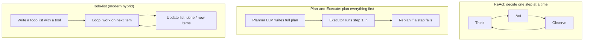

[← Day 2](../../week-1/theory/day-02-tool-calling.md) · [Week 1 overview](../README.md) · [▶️ Practice notebook](../practice/day-03-agent-loop.ipynb) · [Day 4 →](../../week-1/theory/day-04-workflow-patterns.md)

## Day 3 — The agent loop, reasoning & planning

⏱ 60 min theory · 30 min lab · 60 min capstone

**Goals:** write a production-quality loop from memory; understand stop reasons, budgets, ReAct vs plan-and-execute vs todo lists, and thinking/effort.


### 🎥 Watch first (short videos)
- 🎥 [ReAct AI Agents, clearly explained!](https://www.youtube.com/watch?v=vFdIrZyKEwQ): *community explainer*. Thought → Action → Observation
- 🎥 [The Loop Every AI Agent Runs — ReAct Explained](https://www.youtube.com/watch?v=30G13kiyAWs): *community explainer*. walks through the 2022 paper

> Durations are approximate. "Community explainer" means an independent creator; the written links in each section are the primary sources.

### 3.1 The loop: think → act → observe

You built this in `02_agent_loop.py`. Here is the minimal core, with the production guards added:

```python
def run_agent(messages, tools, system, max_steps=15, max_cost=0.50):
    for step in range(max_steps):
        r = client.messages.create(model=MODEL, max_tokens=16000, system=system,
                                   tools=tools, messages=messages)
        tracker.add(MODEL, r.usage)
        messages.append({"role": "assistant", "content": r.content})

        if r.stop_reason == "end_turn":                      # model decided it's done
            return next((b.text for b in r.content if b.type == "text"), "")
        if r.stop_reason in ("refusal", "max_tokens"):       # handle, don't crash
            return f"[stopped: {r.stop_reason}]"
        if tracker.total() > max_cost:                       # budget guard
            return "[stopped: cost budget exceeded]"

        results = []
        for b in r.content:
            if b.type == "tool_use":
                out, err = run_tool(b.name, b.input)
                results.append({"type": "tool_result", "tool_use_id": b.id, "content": out, "is_error": err})
        messages.append({"role": "user", "content": results})
    return "[stopped: step limit]"
```

**Stop reasons you must handle**

| `stop_reason` | Meaning | What to do |
|---|---|---|
| `tool_use` | Wants tools | Run them, loop |
| `end_turn` | Finished | Return the answer |
| `max_tokens` | Reply cut off | Raise `max_tokens` or continue |
| `pause_turn` | A server-side tool paused a long turn | Append the reply and call again |
| `refusal` | A safety classifier declined | Show a message, log it, optionally fall back |

**Practical lessons**
- **Always have three budgets:** steps, cost and wall-clock time. Unbounded agents become bills.
- **Log every step** (tool name, args, result size, tokens). You'll turn this into tracing on Day 13.
- The loop stays the same across Claude Code, OpenAI Agents SDK and LangGraph's prebuilt agent. Only the extras differ.

📖 Deep dive: 📘⭐ [Claude Agent SDK — How the agent loop works](https://code.claude.com/docs/en/agent-sdk/agent-loop)

### 3.2 Planning styles: ReAct vs plan-and-execute vs todo list



| Style | How | Pros | Cons | Use when |
|---|---|---|---|---|
| **ReAct** | Reason and act each step | Adapts to every observation | Can wander or forget the big picture on long tasks | Short-to-medium tasks (≤ ~15 steps) |
| **Plan-and-Execute** | Plan once, then execute (often with a cheaper model) | Predictable, cheap executor, plan is auditable | Brittle when reality differs from the plan | Well-understood multi-step jobs, report pipelines |
| **Todo list** | ReAct plus a `todo_write` tool the model updates | Keeps the goal visible, replans naturally, the user can see progress | Uses slightly more tokens | Long tasks. Claude Code works this way |

A todo tool is tiny:

```python
TODOS = []
def todo_write(items: list[dict]) -> str:
    """items: [{"task": "...", "status": "pending|in_progress|done"}]. Replaces the whole list."""
    TODOS[:] = items
    return "\n".join(f"[{ {'pending':' ','in_progress':'~','done':'x'}[i['status']] }] {i['task']}" for i in items)
```

**Why it works (intuition):** the model's "working memory" is its context. Rewriting the plan regularly keeps it near the **end** of the context, where attention is strongest (see "lost in the middle", Day 5).

📖 Deep dive: 📄 [ReAct paper](https://arxiv.org/abs/2210.03629) · 📄 [Reflexion — verbal self-reflection (2023)](https://arxiv.org/abs/2303.11366)

### 3.3 Thinking, effort and interleaved reasoning

**Intuition.** Modern models can "think" (produce hidden reasoning tokens) before answering, **and between tool calls** (interleaved thinking): *"the search returned nothing → maybe the email has a typo → let me try a partial search."* Reflexion-style self-critique is now built into the model.

**The control knob is `effort`** (`low | medium | high | xhigh | max`):

```python
r = client.messages.create(
    model=MODEL, max_tokens=16000, tools=TOOLS, messages=messages,
    output_config={"effort": "low"},     # simple support lookups
)
# Opus 5.5 always thinks (adaptive); effort controls how much. Default is "medium".
```

| Effort | Cost/latency | Use for |
|---|---|---|
| `low` | Cheapest, fastest | Classification, simple lookups, subagents |
| `medium` | Balanced | Most support/agent turns |
| `high` / `xhigh` | Expensive | Hard reasoning, coding, long agentic work |
| `max` | Highest | When correctness matters more than cost |

**Practical lessons**
- Tune effort **per route**, not globally. The router (Day 4) can pick the effort level.
- Lower effort also means fewer, more consolidated tool calls and shorter replies.
- Measure with evals (Day 11) before raising effort "just in case".
- Older pattern: the "think tool" (a no-op tool where the model writes notes). It's useful history, but native interleaved thinking mostly replaces it.

📖 Deep dive: [Anthropic — The "think" tool](https://www.anthropic.com/engineering/claude-think-tool) (history and when it still helps)

### 3.4 Stopping, looping and getting stuck

Common failure modes and fixes:

| Failure | Symptom | Fix |
|---|---|---|
| Infinite loop | Same tool, same args, again and again | Detect repeats (hash of name + args) and inject "you already tried X" |
| Premature stop | Says "done" without verifying | Prompt: "verify with a tool before finishing", or add a checker step |
| Over-calling | 20 lookups for a 2-step task | Better tool design, lower effort |
| Hallucinated tool result | Claims a fact no tool returned | System prompt: "Only state order facts returned by tools", plus a trajectory eval (Day 11) |

```python
from collections import Counter
seen = Counter()
def repeated(b):                       # call inside the loop for each tool_use block
    key = (b.name, json.dumps(b.input, sort_keys=True))
    seen[key] += 1
    return seen[key] >= 3              # third identical call → warn the model / stop
```

### 🧪 Lab → do it in the practice notebook 3 — Planning styles race (30 min)
Give the agent a multi-step task: *"For every gold customer, list undelivered orders and draft one apology email per customer."*
1. Run plain ReAct. 2. Run with a `todo_write` tool. 3. Run plan-and-execute (Opus 5.5 writes a plan, Haiku 5.5 executes each step).
Compare steps, cost and correctness in a table. Then try `effort` = low vs high.

### 🏗 Capstone — Day 3: `shopease/agent.py`
Wire Day 2's tools into `run_agent` with a ShopEase system prompt (role, tone, "never promise refunds the tools don't confirm", escalation rules). Add step/cost/time budgets and repeat detection. Test it on 10 realistic customer messages and save the transcripts. You'll turn them into evals on Day 11.

### ✅ Checkpoint
1. List the stop reasons and what your loop does for each.
2. When does plan-and-execute beat ReAct? When does it fail?
3. Why does rewriting a todo list help on long tasks? (Hint: where in the context does it end up?)
4. You lower effort from high to low and accuracy drops 2% while cost drops 60%. How do you decide?

---

**Next:** open the [practice notebook](../practice/day-03-agent-loop.ipynb) · capstone milestone in [projects/shopease-support-agent](../../projects/shopease-support-agent/README.md#milestones-build-your-own-version-alongside-the-course)

[← Day 2](../../week-1/theory/day-02-tool-calling.md) · [Week 1 overview](../README.md) · [▶️ Practice notebook](../practice/day-03-agent-loop.ipynb) · [Day 4 →](../../week-1/theory/day-04-workflow-patterns.md)
