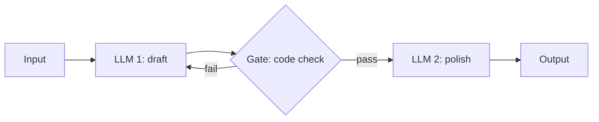
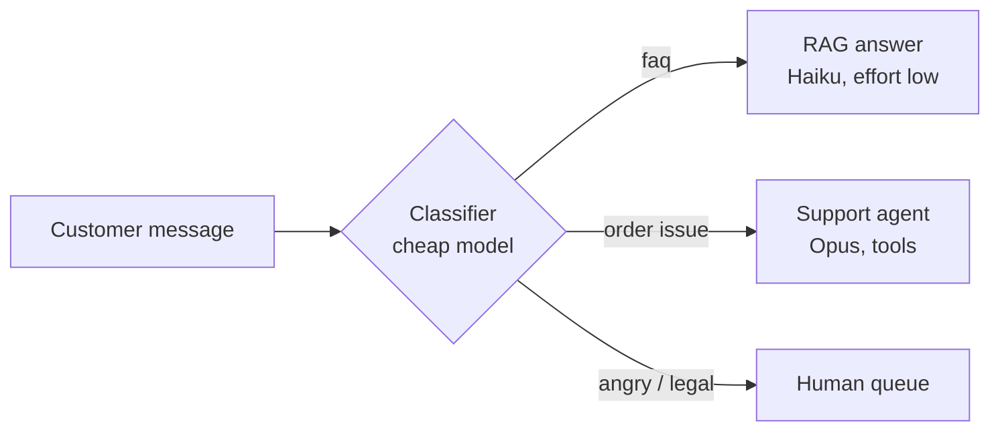
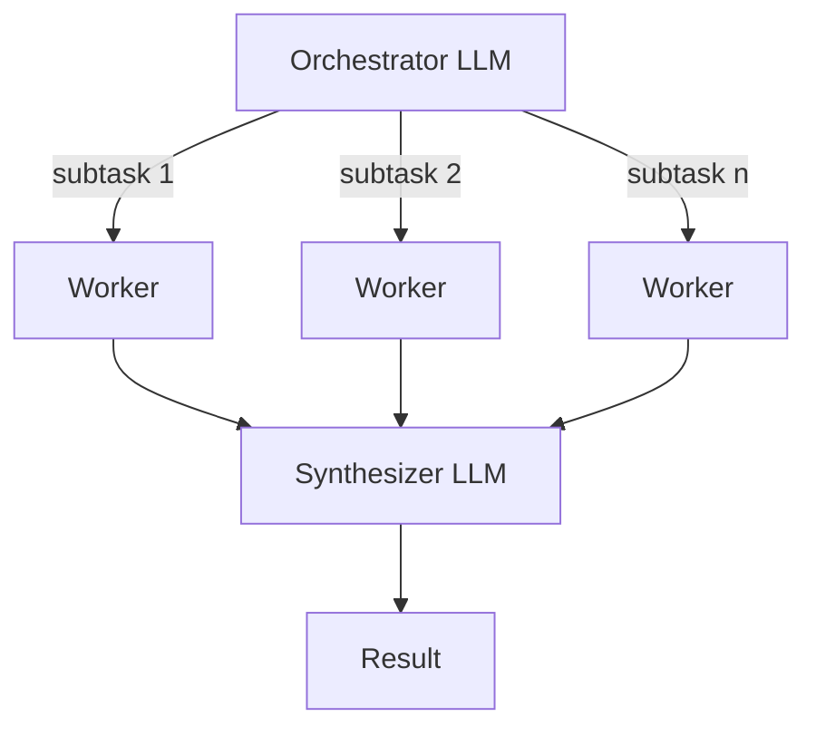

[← Day 3](../../week-1/theory/day-03-agent-loop-and-planning.md) · [Week 1 overview](../README.md) · [▶️ Practice notebook](../practice/day-04-workflow-patterns.ipynb) · [Day 5 →](../../week-1/theory/day-05-context-engineering-and-caching.md)

## Day 4 — Workflow patterns: the building blocks of production systems

⏱ 60 min theory · 30 min lab · 60 min capstone

**Goals:** know the 5 core workflow patterns, their trade-offs and how to combine them; put a router in front of the capstone agent.

> These five patterns come from Anthropic's *Building Effective Agents*. Most production "agent" systems are compositions of them, with an agent loop in one or two places.


### 🎥 Watch first (short videos)
- 🎥 [Agentic AI Frameworks Explained: Workflows, Multi-Agent, & Production](https://www.youtube.com/watch?v=ZVPlLaehjLk): *IBM Technology*. linear workflows vs autonomous agents
- 🎥 [5 Core Workflow Patterns Behind Production Agentic AI Systems](https://www.youtube.com/watch?v=cRxiduiz0l8): *community explainer*. the patterns from today's notes
- 🎥 [How We Build Effective Agents (re-watch the patterns part)](https://www.youtube.com/watch?v=D7_ipDqhtwk): *Barry Zhang, Anthropic*. ~15 min

> Durations are approximate. "Community explainer" means an independent creator; the written links in each section are the primary sources.

### 4.1 Prompt chaining

**Intuition:** an assembly line. Each LLM call does one small job and passes the result on. Between steps you can add **gates**: plain code checks such as "is the outline under 10 bullets?".



```python
def chain(ticket):
    summary = ask(CHEAP_MODEL, f"Summarize this ticket in 2 lines:\n{ticket}")
    if len(summary) > 400:                               # gate (plain code)
        summary = ask(CHEAP_MODEL, f"Shorten to 2 lines:\n{summary}")
    return ask(MODEL, f"Write a polite reply based on this summary:\n{summary}")
```
*(`ask(model, prompt)` is a one-line helper: `client.messages.create(...)` → return the text.)*

- **Trade-off:** more calls (latency), but each one is easier, so accuracy is higher.
- **Use when:** the task splits cleanly into fixed steps (draft → check → translate).

### 4.2 Routing

**Intuition:** a hospital front desk. Classify first, then send the input to the right specialist, which can be a cheaper model, a different prompt or a non-LLM path.



```python
from pydantic import BaseModel
from typing import Literal
class Route(BaseModel):
    route: Literal["faq", "order_issue", "human"]
    reason: str

def route(msg):
    r = client.messages.parse(model=CHEAP_MODEL, max_tokens=500, output_format=Route,
        system="Classify ShopEase support messages. 'human' = legal threats, abuse, or explicit request for a person.",
        messages=[{"role": "user", "content": msg}])
    return r.parsed_output
```

- **Trade-off:** misroutes become a new failure mode, so you need an eval on the router itself.
- **Use when:** inputs fall into distinct groups with very different cost and difficulty. This is the **single biggest cost optimization** in support systems: most traffic is easy.

### 4.3 Parallelization (sectioning and voting)

**Intuition:** split the work among several people (*sectioning*), or ask several people the same question and take the majority (*voting*).

```python
import concurrent.futures as cf
checks = {"tone":   "Is this reply polite? yes/no",
          "policy": "Does this reply promise anything not in the policy? yes/no",
          "pii":    "Does this reply reveal another customer's data? yes/no"}
def review(reply):
    with cf.ThreadPoolExecutor() as pool:                       # sectioning: 3 checks at once
        futs = {k: pool.submit(ask, CHEAP_MODEL, f"{q}\n\nReply:\n{reply}") for k, q in checks.items()}
    return {k: f.result() for k, f in futs.items()}
```

**Voting math.** If one judge is right with probability *p* = 0.8 and judges are independent, a majority of 3 is right with probability:

$$P = p^3 + 3p^2(1-p) = 0.512 + 0.384 = 0.896$$

⚠️ Same model + same prompt ⇒ errors are **correlated**, so the real gain is smaller. Vary prompts or models to reduce correlation.

- **Use when:** subtasks are independent (sectioning) or you need higher confidence on a yes/no decision (voting).

### 4.4 Orchestrator–workers

**Intuition:** a project manager LLM breaks the task down **at runtime** and sends pieces to workers. It differs from parallelization because the subtasks aren't known in advance.



- **Trade-off:** flexible but harder to predict. This is the bridge to multi-agent systems (Day 9).
- **Use when:** "Update every file affected by this change" or "Research these 6 competitors", where the number and kind of subtasks depend on the input.

### 4.5 Evaluator–optimizer

**Intuition:** writer + editor. One LLM produces, another critiques against clear criteria, and they loop until the work passes or a limit is hit.

```python
def write_with_review(task, max_rounds=3):
    draft = ask(MODEL, task)
    for _ in range(max_rounds):
        verdict = ask(CHEAP_MODEL, f"Criteria: polite, <120 words, cites the policy.\n"
                                   f"Reply PASS or a list of fixes.\n\nDraft:\n{draft}")
        if verdict.strip().startswith("PASS"):
            break
        draft = ask(MODEL, f"Revise the draft using this feedback:\n{verdict}\n\nDraft:\n{draft}")
    return draft
```

- **Use when:** clear criteria exist and feedback actually improves the output (writing, translation, code that must pass tests).
- **Don't use when:** the critic can't tell good from bad. Then you only pay for extra loops.

### 4.6 Choosing and combining patterns

| Pattern | Latency | Cost | Predictability | Best for |
|---|---|---|---|---|
| Chaining | ↑ (sequential) | Low–Med | ✅✅ | Fixed multi-step transforms |
| Routing | ≈ | ⬇ (saves money) | ✅✅ | Mixed traffic |
| Parallelization | ⬇ (concurrent) | ↑ | ✅ | Independent checks, voting |
| Orchestrator–workers | ↑ | ↑↑ | ⚠️ | Dynamic decomposition |
| Evaluator–optimizer | ↑↑ (loops) | ↑↑ | ⚠️ | Quality-critical output with clear criteria |
| Autonomous agent | ↑↑↑ | ↑↑↑ | ❌ | Open-ended tasks |

**Practical lessons**
- Real systems combine them, for example *router → (FAQ chain | agent) → parallel guardrail checks → reply*.
- Build each pattern in plain code first. You'll see on Day 14 that frameworks mostly wrap these.

📖 Deep dive: ⭐ [Anthropic — Building Effective Agents (patterns section)](https://www.anthropic.com/engineering/building-effective-agents) · 🧑‍💻 [Anthropic cookbook (agent pattern notebooks)](https://github.com/anthropics/claude-cookbooks) · [LangChain — How to think about agent frameworks](https://www.langchain.com/blog/how-to-think-about-agent-frameworks)

### 🧪 Lab → do it in the practice notebook 4 — Pattern gym (30 min)
Implement chaining, routing and evaluator–optimizer on 10 sample tickets. For each pattern, log latency, cost and your own 1–5 quality score in a pandas DataFrame and plot cost vs quality.

### 🏗 Capstone — Day 4: `shopease/router.py`
Router (Haiku + structured output) → `faq` path (one call over the policy text for now; RAG on Day 6), `order_issue` path (your Day 3 agent) or `human` path (a stub queue). Measure how much traffic avoids the expensive agent across 30 synthetic messages, and estimate the money saved.

### ✅ Checkpoint
1. What is the difference between parallelization and orchestrator–workers?
2. Why are 3 votes from the same model and prompt worth less than the formula suggests?
3. Where would you add a *gate* in a chain, and why should it be code rather than an LLM?
4. Design the pattern combination for a "weekly sales report" product.

---

**Next:** open the [practice notebook](../practice/day-04-workflow-patterns.ipynb) · capstone milestone in [projects/shopease-support-agent](../../projects/shopease-support-agent/README.md#milestones-build-your-own-version-alongside-the-course)

[← Day 3](../../week-1/theory/day-03-agent-loop-and-planning.md) · [Week 1 overview](../README.md) · [▶️ Practice notebook](../practice/day-04-workflow-patterns.ipynb) · [Day 5 →](../../week-1/theory/day-05-context-engineering-and-caching.md)
