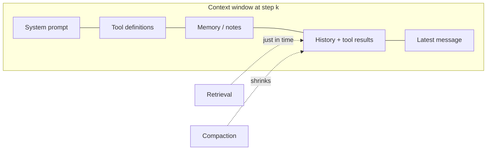

[← Day 4](../../week-1/theory/day-04-workflow-patterns.md) · [Week 1 overview](../README.md) · [▶️ Practice notebook](../practice/day-05-context-and-caching.ipynb) · [Day 6 →](../../week-1/theory/day-06-rag-for-agents.md)

## Day 5 — Context engineering & prompt caching

⏱ 75 min theory · 30 min lab · 45 min capstone

**Goals:** treat the context window as a scarce resource; learn context rot, compaction, just-in-time retrieval and caching, with the math behind the savings.


### 🎥 Watch first (short videos)
- 🎥 [What Is Context Engineering? Why It Matters for AI Agents](https://www.youtube.com/watch?v=Qx0fCqpkBus): *IBM Technology (Anna Gutowska)*. prompt vs context engineering
- 🎥 [What is Prompt Caching?](https://www.youtube.com/watch?v=axuTuZ9ERv8): *community explainer*. why a stable prefix saves money
- 🎥 [From Context Engineering to AI Agent Harnesses (optional, longer)](https://www.youtube.com/watch?v=2Muxy3wE-E0): *Lance Martin (LangChain), High Signal podcast*. deep dive: reduce, offload, isolate context

> Durations are approximate. "Community explainer" means an independent creator; the written links in each section are the primary sources.

### 5.1 From prompt engineering to context engineering

**Intuition.** Prompt engineering = writing *one good instruction*. Context engineering = deciding **everything** the model sees at **every step**: system prompt, tool definitions, retrieved docs, history, tool results and memory. For agents, the second matters far more, because the context changes every loop.



**Writing good system prompts ("the right altitude"):**
- ❌ Too low: brittle if/else rules ("If the user says X, reply Y").
- ❌ Too high: vague ("be helpful").
- ✅ Right altitude: role, goals, principles, hard constraints and examples of good behavior, organized in sections (`## Role`, `## Tools`, `## Policies`, `## Output style`).

📖 Deep dive: ⭐ [Anthropic — Effective context engineering for AI agents](https://www.anthropic.com/engineering/effective-context-engineering-for-ai-agents)

### 5.2 Context rot and "lost in the middle"

**Intuition.** More context isn't free attention. As inputs grow, models get *less reliable* at using any one fact, and facts in the **middle** of long contexts are used worst.

```
Accuracy
  ▲  ●                                   ●      "Lost in the middle" (Liu et al., 2023):
  │    ●                              ●          U-shaped curve. Facts at the start and end
  │       ●                        ●             are used best.
  │          ●   ●   ●   ●   ●  ●
  └────────────────────────────────────► position of the relevant fact in the context
     start                 middle            end
```

**Practical consequences**
- Put **instructions at the top** (system) and the **current task/question at the end**.
- Keep the context **lean**: drop stale tool outputs and summarize old turns.
- A 1M-token window is a *ceiling*, not a target. Quality per token drops as you fill it.

📖 Deep dive: 📄 [Lost in the Middle (Liu et al., 2023)](https://arxiv.org/abs/2307.03172) · [Chroma — Context Rot (2025)](https://research.trychroma.com/context-rot)

### 5.3 Techniques to keep context small

| Technique | What it does | Pros | Cons | Use when |
|---|---|---|---|---|
| **Tool-output truncation** | Cap each result (e.g. 2k tokens) | Trivial, big win | Can cut needed info | Always |
| **Context editing** | Remove old tool results from history | Keeps reasoning, drops bulk | Model can't re-read removed data | Long tool-heavy loops |
| **Compaction** | Summarize old history into a short block | Unlimited-length sessions | Summary can lose details | Long conversations / long tasks |
| **Just-in-time retrieval** | Keep *pointers* (file paths, ids) and load on demand | Tiny context, fresh data | More tool calls | Large corpora, codebases |
| **Structured notes / memory** | Agent writes progress notes to a file | Survives resets | Needs a discipline in the prompt | Multi-hour tasks (Day 7) |
| **Subagents** | Delegate messy work, get a summary back | Isolates noise | Token cost, info loss | Research/exploration (Day 9) |

Simple manual context editing:

```python
def trim_old_tool_results(messages, keep_last=3, placeholder="[old tool result removed]"):
    """Keep only the last `keep_last` tool results in full; shrink older ones."""
    seen = 0
    for msg in reversed(messages):
        if msg["role"] == "user" and isinstance(msg["content"], list):
            for block in msg["content"]:
                if isinstance(block, dict) and block.get("type") == "tool_result":
                    seen += 1
                    if seen > keep_last:
                        block["content"] = placeholder
    return messages
```

Server-side versions exist: **context editing** (`clear_tool_uses_20250919`) and **compaction** (`compact_20260112`):

```python
r = client.beta.messages.create(
    betas=["compact-2026-01-12"], model=MODEL, max_tokens=16000, messages=messages,
    context_management={"edits": [{"type": "compact_20260112"}]},   # summarizes when context gets large
)
messages.append({"role": "assistant", "content": r.content})       # keep the compaction block!
```

> ⚠️ **Editing history interacts with caching.** Any change to earlier messages invalidates the cache from that point on (5.4). Prefer to trim in big, rare batches, or use the server-side features, which are designed for this.

📖 Deep dive: 📘 [Claude docs — Context editing](https://platform.claude.com/docs/en/build-with-claude/context-editing) · 📘 [Claude docs — Compaction](https://platform.claude.com/docs/en/build-with-claude/compaction)

### 5.4 Prompt caching: the biggest free win

**Intuition.** Each loop step resends the same prefix (system + tools + history). Caching lets the provider store the processed prefix, so the next call **reads** it at a fraction of the price and much faster. It's a **prefix match**: change one byte early and everything after it is a miss.

```
call 1: [system][tools][msg1][msg2]                   ← write cache (≈1.25× price)
call 2: [system][tools][msg1][msg2][tool result]      ← prefix read from cache (≈0.05–0.1× price)
                └───────── cached ─────────┘ └ new ┘
```

**Savings math.** Prefix of `P` tokens reused over `n` calls, base price `c` per token, write multiplier `w ≈ 1.25`, read multiplier `r` (Opus 5.5: $0.20 vs $4.00 ⇒ r = 0.05):

$$\text{no cache} = nPc \qquad \text{cache} = wPc + (n-1)\,rPc \qquad \text{saving} \approx 1 - \frac{w + (n-1)r}{n}$$

For `n = 10`: saving ≈ 1 − (1.25 + 0.45)/10 = **83%** on the prefix tokens. Latency to first token also drops a lot for long prefixes.

```python
r = client.messages.create(
    model=MODEL, max_tokens=16000, tools=TOOLS, messages=messages,
    system=SYSTEM_PROMPT,
    cache_control={"type": "ephemeral"},       # automatic: caches up to the last cacheable block
)
print(r.usage.cache_creation_input_tokens, r.usage.cache_read_input_tokens, r.usage.input_tokens)
```

**Silent cache killers (very common in real codebases):**
- `datetime.now()` or a request id in the system prompt → put volatile data **at the end**.
- Tools in random order or `json.dumps` without `sort_keys` → make them deterministic.
- Swapping tool sets per request → keep one stable tool list.
- Prompts shorter than the model's minimum cacheable length → silently not cached.

| ✅ Do | ❌ Don't |
|---|---|
| Stable system + tools first, conversation after | Timestamps at the top |
| Append-only history | Rewriting old messages every turn |
| Check `cache_read_input_tokens > 0` in logs | Assume caching works |

📖 Deep dive: 📘⭐ [Claude docs — Prompt caching](https://platform.claude.com/docs/en/build-with-claude/prompt-caching)

### 🧪 Lab → do it in the practice notebook 5 — Measure it (30 min)
1. Run a 10-step agent conversation **without** caching, then **with** it. Plot input cost per step for both runs.
2. Add `datetime.now()` to the system prompt and watch `cache_read_input_tokens` drop to 0.
3. Put a key fact in the middle of a 50k-token filler document vs at the end, and ask about it 5 times each. Do you see any difference?

### 🏗 Capstone — Day 5
Restructure the ShopEase prompt (stable sections, volatile data last), enable caching, add tool-output truncation and old-result trimming, and log cache hit rate per conversation. Target: >70% of input tokens served from cache in a 10-turn chat.

### ✅ Checkpoint
1. Why does adding the current time to the system prompt cost money?
2. Calculate the cache saving for a 20-call session with r = 0.1.
3. When would you choose compaction instead of context editing?
4. What's "just-in-time" context, and how does Claude Code use it for codebases?

---

**Next:** open the [practice notebook](../practice/day-05-context-and-caching.ipynb) · capstone milestone in [projects/shopease-support-agent](../../projects/shopease-support-agent/README.md#milestones-build-your-own-version-alongside-the-course)

[← Day 4](../../week-1/theory/day-04-workflow-patterns.md) · [Week 1 overview](../README.md) · [▶️ Practice notebook](../practice/day-05-context-and-caching.ipynb) · [Day 6 →](../../week-1/theory/day-06-rag-for-agents.md)
