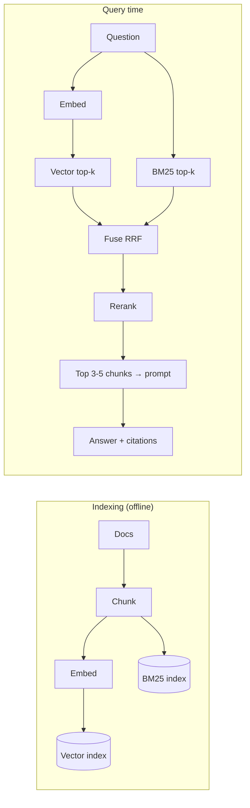

[← Day 5](../../week-1/theory/day-05-context-engineering-and-caching.md) · [Week 1 overview](../README.md) · [▶️ Practice notebook](../practice/day-06-rag.ipynb) · [Day 7 →](../../week-1/theory/day-07-memory.md)

## Day 6 — RAG for agents: retrieval that actually works

⏱ 75 min theory · 30 min lab · 45 min capstone

**Goals:** understand embeddings and similarity math, chunking, hybrid search, reranking and contextual retrieval; know when *agentic search* beats classic RAG.


### 🎥 Watch first (short videos)
- 🎥 [What is Retrieval-Augmented Generation (RAG)?](https://www.youtube.com/watch?v=T-D1OfcDW1M): *IBM Technology (Marina Danilevsky)*. ~6 min classic intro
- 🎥 [RAG Versus Agentic AI: Connecting Data for Smarter Systems](https://www.youtube.com/watch?v=6oqGeUYBReA): *IBM Technology*. classic RAG vs agentic retrieval
- 🎥 [Vector Databases simply explained! (Embeddings & Indexes)](https://www.youtube.com/watch?v=dN0lsF2cvm4): *community explainer*. embeddings intuition

> Durations are approximate. "Community explainer" means an independent creator; the written links in each section are the primary sources.

### 6.1 Embeddings and cosine similarity

**Intuition.** An embedding model turns text into a vector (a list of numbers, e.g. 384–3072 long) so that *similar meaning → nearby vectors*. "refund my order" and "I want my money back" end up close together even though they share no words.

$$\cos(\mathbf{a},\mathbf{b}) = \frac{\mathbf{a}\cdot\mathbf{b}}{\lVert\mathbf{a}\rVert\,\lVert\mathbf{b}\rVert}\in[-1,1]$$

1 means the same direction (same meaning), 0 means unrelated.

```python
import numpy as np
def cosine(a, b): return float(np.dot(a, b) / (np.linalg.norm(a) * np.linalg.norm(b)))
print(cosine(np.array([1, 2, 0]), np.array([2, 4, 0.1])))   # ≈ 0.999 (same direction)
print(cosine(np.array([1, 0, 0]), np.array([0, 1, 0])))     # 0.0 (unrelated)
```

In the lab you'll use a free local model: `sentence-transformers` (`all-MiniLM-L6-v2`), which runs on a Colab CPU.

### 6.2 The classic RAG pipeline



**Chunking trade-offs**

| Chunk size | Pros | Cons |
|---|---|---|
| Small (~100–200 tokens) | Precise matches | Loses surrounding context |
| Large (~800–1500 tokens) | Full context | Noisy, dilutes the embedding |
| ✅ Typical default | ~300–600 tokens with ~10–20% overlap, split on headings/paragraphs | Tune with evals |

### 6.3 Hybrid search: BM25 + vectors, fused with RRF

**Intuition.** Embeddings capture *meaning* but miss exact tokens such as order ids, error codes and product names. BM25 (classic keyword search) catches those. Use both.

**BM25 in one line.** A term scores higher if it's rare across documents (IDF) and frequent in this document, with diminishing returns and a length penalty:

$$\text{BM25}(q,d)=\sum_{t\in q}\text{IDF}(t)\cdot\frac{f(t,d)\,(k_1+1)}{f(t,d)+k_1\left(1-b+b\frac{|d|}{\text{avgdl}}\right)}$$

**Reciprocal Rank Fusion** combines ranked lists without having to calibrate scores (k ≈ 60):

$$\text{RRF}(d)=\sum_{\text{lists } L}\frac{1}{k+\text{rank}_L(d)}$$

```python
def rrf(*rankings, k=60):
    scores = {}
    for ranking in rankings:                     # each ranking: list of doc ids, best first
        for rank, doc in enumerate(ranking, 1):
            scores[doc] = scores.get(doc, 0) + 1 / (k + rank)
    return sorted(scores, key=scores.get, reverse=True)

print(rrf(["returns", "shipping", "warranty"], ["warranty", "returns", "payments"]))
# ['returns', 'warranty', 'shipping', 'payments']  ← agreed-on docs rise to the top
```

### 6.4 Reranking and contextual retrieval

- **Reranking:** retrieve ~20–50 candidates cheaply, then score each (query, chunk) pair with a stronger model (a cross-encoder like `cross-encoder/ms-marco-MiniLM-L-6-v2`, or a cheap LLM) and keep the top 3–5. Precision improves a lot, at the cost of some added latency.
- **Contextual retrieval (Anthropic, 2024):** before embedding, prepend a short LLM-written context to each chunk. For example: *"This chunk is from ShopEase's Returns policy, section on electronics."* Chunks stop being "orphaned". Anthropic reported large reductions in retrieval failures when they combined contextual embeddings with contextual BM25 and reranking. Cheap to do with a small model (Flash-Lite) plus caching of the full document.

```python
def contextualize(doc_text, chunk):
    return ask(f"<document>{doc_text}</document>\nHere is a chunk:\n<chunk>{chunk}</chunk>\n"
               "Write 1 short sentence situating this chunk within the document. Only the sentence.",
               model=CHEAP_MODEL) + "\n" + chunk
```

📖 Deep dive: ⭐ [Anthropic — Introducing Contextual Retrieval](https://www.anthropic.com/engineering/contextual-retrieval)

### 6.5 Classic RAG vs agentic search

| | Classic RAG (retrieve once, then answer) | Agentic search (retrieval is a *tool*) |
|---|---|---|
| Flow | Fixed: query → top-k → answer | Agent searches, reads, refines the query, searches again |
| Latency/cost | ✅ Low, predictable | ❌ Higher |
| Multi-hop questions | ❌ Weak | ✅ Strong |
| Best for | FAQ bots, doc Q&A at scale | Research, coding (grep/glob), complex support |

**Evolution:** 2023 = "put a vector DB behind everything". 2025+ = coding agents mostly dropped vector DBs for **grep + file reads** (agentic search), because precise, fresh, explainable search beat fuzzy similarity for code. For prose knowledge bases, hybrid RAG exposed as a tool is the production sweet spot.

```python
SEARCH_TOOL = {"name": "search_policies",
  "description": "Search ShopEase policy documents. Returns top passages with their source file. "
                 "Use for any question about returns, shipping, warranty or payments. Try rephrasing if results are weak.",
  "input_schema": {"type": "object", "properties": {"query": {"type": "string"}}, "required": ["query"]}}
```

**Practical lessons**
- **Evaluate retrieval separately from generation:** measure recall@k ("is the right chunk in the top 5?") before you blame the LLM.
- Always return **sources** and ask the model to cite them. That builds user trust and makes bad answers easy to debug.
- Start with BM25 alone. It's often surprisingly strong, and you can add vectors when evals show a need.

### 🧪 Lab → do it in the practice notebook 6 — Build hybrid RAG (Colab, CPU only)
`pip install sentence-transformers rank_bm25`. Chunk the policy docs plus 20 synthetic FAQ entries, then build BM25, vector and RRF indexes. Write 15 questions with known answer chunks and compute recall@3 for BM25, vector, hybrid and hybrid + rerank. Plot the four bars. 🆓 Swap: everything except generation is already free.

### 🏗 Capstone — Day 6: `shopease/rag.py`
Hybrid retrieval + rerank behind the `search_policies` tool, returning `[{source, passage}]`. Update the FAQ path and the agent to cite sources. Add 10 retrieval test cases to the eval folder.

### ✅ Checkpoint
1. Why does BM25 find "O1007" when an embedding search might not?
2. Compute RRF scores by hand for two short rankings.
3. When is agentic search worth its extra cost?
4. What does contextual retrieval fix, and how does caching make it cheap?

---

**Next:** open the [practice notebook](../practice/day-06-rag.ipynb) · capstone milestone in [projects/shopease-support-agent](../../projects/shopease-support-agent/README.md#milestones-build-your-own-version-alongside-the-course)

[← Day 5](../../week-1/theory/day-05-context-engineering-and-caching.md) · [Week 1 overview](../README.md) · [▶️ Practice notebook](../practice/day-06-rag.ipynb) · [Day 7 →](../../week-1/theory/day-07-memory.md)
