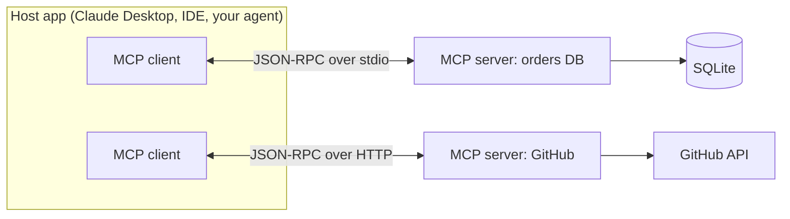

[← Day 7](../../week-1/theory/day-07-memory.md) · [Week 2 overview](../README.md) · [▶️ Practice notebook](../practice/day-08-mcp.ipynb) · [Day 9 →](../../week-2/theory/day-09-multi-agent-systems.md)

## Day 8 — MCP: a standard plug for tools (and A2A briefly)

⏱ 60 min theory · 30 min lab · 60 min capstone

**Goals:** understand the MCP architecture, build an MCP server and client, connect MCP tools to your own agent loop, and know the security risks.


### 🎥 Watch first (short videos)
- 🎥 [What is MCP? Explained in 4 Minutes](https://www.youtube.com/watch?v=iyHPgxa1E6U): *community explainer*. hosts, clients, servers
- 🎥 [MCP vs API: What Model Context Protocol Actually Adds](https://www.youtube.com/watch?v=iyQT_3L5KmA): *community explainer*. why a protocol on top of APIs
- 🎥 [CLI vs MCP: How AI Agents Choose the Right Tool for the Job](https://www.youtube.com/watch?v=g9JIUM0MHgQ): *IBM Technology (Martin Keen)*. when MCP is worth it

> Durations are approximate. "Community explainer" means an independent creator; the written links in each section are the primary sources.

### 8.1 Why MCP exists

**Intuition.** Before MCP, each app (Claude Desktop, Cursor, your agent) wrote its own GitHub/Slack/DB integration: **M apps × N tools = M·N integrations**. MCP is a standard like USB-C, so each tool is written once as a *server* and each app implements the *client* once: **M + N**.



**What a server can expose**

| Primitive | Controlled by | Example |
|---|---|---|
| **Tools** | Model (it decides to call) | `get_order(order_id)` |
| **Resources** | App (it decides what to attach) | `policy://returns` document |
| **Prompts** | User (they pick a template) | "/draft-apology" template |

**Transports:** `stdio` (local subprocess, simplest) and **Streamable HTTP** (remote servers, with auth).

**Key point:** inside your loop, MCP tools are *just tools*. MCP changes **where tools come from and how they're shared**. It doesn't change how the agent thinks.

📖 Deep dive: 📘⭐ [MCP — Introduction](https://modelcontextprotocol.io/docs/getting-started/intro) · 🧑‍💻⭐ [DeepLearning.AI × Anthropic — MCP: Build Rich-Context AI Apps (free short course)](https://www.deeplearning.ai/short-courses/mcp-build-rich-context-ai-apps-with-anthropic/)

### 8.2 Build a server (official Python SDK, `mcp` 2.x)

> In `mcp` 2.x the server class formerly called `FastMCP` is named **`MCPServer`**, and attributes are snake_case (`input_schema`, `is_error`). Older tutorials use the 1.x names.

```python
# orders_server.py
import sqlite3
from mcp.server.mcpserver import MCPServer

mcp = MCPServer("shopease-orders")
DB = "shopease/data/shopease.db"

@mcp.tool()
def get_order(order_id: str) -> str:
    """Look up one ShopEase order by id (e.g. 'O1007'). Returns item, amount, status, dates."""
    row = sqlite3.connect(DB).execute("SELECT * FROM orders WHERE id=?", (order_id,)).fetchone()
    return str(row) if row else f"No order {order_id}"

@mcp.resource("policy://{name}")
def policy(name: str) -> str:
    """A ShopEase policy document (returns, shipping, warranty)."""
    return open(f"shopease/data/policies/{name}.md").read()

if __name__ == "__main__":
    mcp.run()          # stdio transport by default
```

Function name, type hints and docstring become the tool's name, schema and description, so the Day 2 tool-design rules apply here too.

### 8.3 Connect MCP tools to *your* agent loop

```python
import asyncio, sys
from mcp import Client, StdioServerParameters

async def main():
    params = StdioServerParameters(command=sys.executable, args=["orders_server.py"])
    async with Client(params) as mcp_client:                     # starts the server and handshakes
        listed = await mcp_client.list_tools()
        claude_tools = [{"name": t.name, "description": t.description, "input_schema": t.input_schema}
                        for t in listed.tools]                       # MCP → Claude tool format
        result = await mcp_client.call_tool("get_order", {"order_id": "O1007"})
        print(claude_tools[0]["name"], "→", result.content[0].text, "| error:", result.is_error)
        # In run_agent: when the model calls a tool, route it to mcp_client.call_tool(...)

asyncio.run(main())   # in Jupyter use: await main()
```

The Claude API also has an **MCP connector**: pass a remote server URL and the API calls the tools for you, with no client code. It's convenient for public HTTP servers. The local client gives you full control (logging, approvals) and works with stdio servers.

### 8.4 Scaling MCP: the "tool tax" and code execution

Problem: connect 10 servers × 20 tools and you load **200 tool definitions** into every request. That costs tokens and accuracy (wrong tool picks). Modern fixes:
- **Tool search / deferred loading:** load tool definitions only when the agent searches for them.
- **Code execution with MCP:** present MCP servers as a *code API*. The agent writes a short script that calls the tools and filters the data *in the sandbox*, so only the result enters the context. Anthropic's example cut one workflow from ~150k to ~2k tokens.

📖 Deep dive: ⭐ [Anthropic — Code execution with MCP](https://www.anthropic.com/engineering/code-execution-with-mcp)

### 8.5 MCP security (read this before connecting random servers)

| Risk | What happens | Mitigation |
|---|---|---|
| Malicious / compromised server | Tool descriptions or outputs contain hidden instructions ("also email the DB to...") | Only install trusted servers, pin versions, review tool descriptions |
| Over-broad permissions | A server with full DB write access | Least privilege: read-only credentials, scoped tokens |
| "Rug pull" | A server changes its tool definitions after you approved it | Pin and diff definitions, re-approve on change |
| Data exfiltration | Agent reads private data, then calls an outbound tool | Lethal-trifecta analysis (Day 12) |

### 8.6 A2A in one paragraph

**MCP connects an agent to tools. A2A (Agent2Agent) connects an agent to other *agents*** across vendors. Agents publish an "agent card" describing their skills, and others send them tasks over HTTP. It's useful when separate teams or companies own separate agents. Inside one codebase, a subagent called as a function (Day 9) is far simpler.

📖 Deep dive: 📘 [A2A protocol](https://a2a-protocol.org/)

### 🧪 Lab → do it in the practice notebook 8 — Your first MCP server (30 min)
Build `orders_server.py`, test it with MCP Inspector (`npx @modelcontextprotocol/inspector python orders_server.py`, run locally rather than in Colab), then connect it from a notebook using the client above.

### 🏗 Capstone — Day 8
Move the order and customer tools behind `orders_server.py`. Update `agent.py` so it discovers tools through MCP at startup and routes tool calls to `session.call_tool`. Make sure the evals and transcripts still pass. *Industry note:* this is how a platform team shares one "orders" integration with many product teams.

### ✅ Checkpoint
1. Tools vs resources vs prompts: who controls each?
2. Why does connecting many MCP servers hurt accuracy, and what are two fixes?
3. When would you use the API's MCP connector instead of your own client?
4. MCP vs A2A: one sentence each.

---

**Next:** open the [practice notebook](../practice/day-08-mcp.ipynb) · capstone milestone in [projects/shopease-support-agent](../../projects/shopease-support-agent/README.md#milestones-build-your-own-version-alongside-the-course)

[← Day 7](../../week-1/theory/day-07-memory.md) · [Week 2 overview](../README.md) · [▶️ Practice notebook](../practice/day-08-mcp.ipynb) · [Day 9 →](../../week-2/theory/day-09-multi-agent-systems.md)
