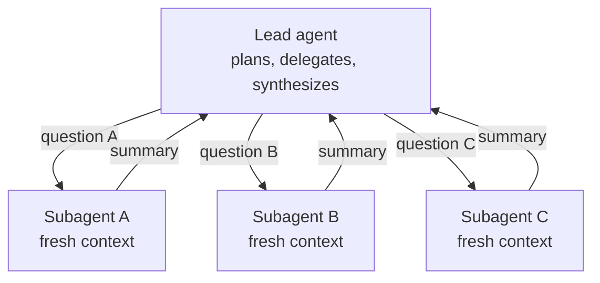

[← Day 8](../../week-2/theory/day-08-mcp.md) · [Week 2 overview](../README.md) · [▶️ Practice notebook](../practice/day-09-multi-agent.ipynb) · [Day 10 →](../../week-2/theory/day-10-code-and-computer-use-agents.md)

## Day 9 — Subagents & multi-agent systems

⏱ 75 min theory · 45 min lab · 30 min capstone

**Goals:** know when multiple agents help and when they hurt; build orchestrator → subagent systems; understand the token economics.


### 🎥 Watch first (short videos)
- 🎥 [Anthropic: How to Build Multi Agent Systems](https://www.youtube.com/watch?v=0HljLKVdtjo): *community walkthrough of Anthropic's post*. lead agent + subagents
- 🎥 [Multi Agent Systems Explained: How AI Agents & LLMs Work Together](https://www.youtube.com/watch?v=sWH0T4Zez6I): *community explainer*. topologies and token cost

> Durations are approximate. "Community explainer" means an independent creator; the written links in each section are the primary sources.

### 9.1 The core idea: a subagent is just a tool

```python
def research_subagent(question: str) -> str:
    """Runs a full agent loop in a FRESH context and returns only a short summary."""
    sub_messages = [{"role": "user", "content": question + "\n\nReturn a ≤150-word summary with sources."}]
    return run_agent(sub_messages, tools=READ_ONLY_TOOLS, system=RESEARCHER_PROMPT, max_steps=10)

SUBAGENT_TOOL = {"name": "research", "description": "Delegate an independent research question. "
    "Returns a short summary. Use for questions that need many lookups.",
    "input_schema": {"type": "object", "properties": {"question": {"type": "string"}}, "required": ["question"]}}
```

**Why it helps:** the subagent may read 50k tokens of messy results, but the main agent only receives 200 tokens. That's **context isolation**, and you can run several subagents **in parallel**.



### 9.2 Two famous opposing views, and why both are right

| Anthropic: multi-agent research system | Cognition: "Don't build multi-agents" |
|---|---|
| A lead agent (Claude Opus 4) with parallel Sonnet 4 subagents beat a single agent by a large margin on Anthropic's internal research eval | Parallel agents make **conflicting decisions** when they work on shared artifacts (code), because each lacks the others' context |
| Works because research is **breadth-first and read-only**: subtasks are independent | Recommends a **single-threaded** agent with excellent context management for coding |
| Cost: multi-agent used ~15× the tokens of a chat (single agents ~4×) | Their later post says what works is narrower: many agents contribute *intelligence*, but **writes stay single-threaded** |

**The synthesis (use this as your rule):**
- ✅ Multi-agent for **parallel, read-only, independent** work: research, search, review, gathering evidence.
- ❌ Avoid it for **tightly coupled writing** to shared state: one codebase, one document, one customer reply.
- Pattern: *many readers, one writer.*

**Token math.** If a chat costs `c`, an agent ~4c and a multi-agent run ~15c, then multi-agent pays off only if the task value V satisfies `V(multi) − V(single) > 11c`. That holds for high-value research and rarely for a support ticket.

📖 Deep dive: ⭐ [Anthropic — How we built our multi-agent research system](https://www.anthropic.com/engineering/multi-agent-research-system) · ⭐ [Cognition — Don't Build Multi-Agents](https://cognition.ai/blog/dont-build-multi-agents) · [Cognition — Multi-Agents: What's Actually Working](https://cognition.ai/blog/multi-agents-working)

### 9.3 Coordination patterns

| Pattern | How | Pros | Cons | Example |
|---|---|---|---|---|
| **Orchestrator–subagents** | Lead delegates, collects summaries | Context isolation, parallel | Lead is a bottleneck; information lost in summaries | Deep research |
| **Handoffs** | Agent A transfers the conversation to agent B (e.g. triage → billing) | Specialized prompts/tools per agent | The receiving agent may lack context; loops | Support triage (OpenAI Agents SDK style) |
| **Pipeline of agents** | Planner → generator → evaluator | Clear roles, good for long tasks | Slow, sequential | Long-running app building |
| **Group chat / swarm** | Agents talk freely | Flexible | Hard to debug, expensive, drifts | Mostly research demos |

**Lessons from Anthropic's research system (apply these to any subagent design):**
1. **Teach the lead to delegate:** each subtask needs an objective, output format, tools to use and clear boundaries. Vague delegation leads to duplicated work.
2. **Scale the work to the question:** 1 subagent for simple facts, many only for broad questions. Put that rule in the prompt.
3. **Subagents return compressed results**, or write them to files and return references.
4. **Use a cheaper model for subagents** (e.g. Flash-Lite) and the stronger one for the lead (e.g. Flash/Pro).
5. **Observability is mandatory.** Multi-agent bugs are emergent, so trace everything (Day 13).

### 🧪 Lab → do it in the practice notebook 9 — Single vs multi-agent research (45 min)
Task: *"Compare ShopEase's return policy with 3 typical e-commerce return policies and list the gaps"* (use the policy docs plus 3 synthetic competitor docs). Build (A) a single agent and (B) a lead + 3 parallel subagents (`CHEAP_MODEL`, `ThreadPoolExecutor`). Compare quality (your rubric), tokens, cost and wall time. Fill in a table and write 3 bullet conclusions.

### 🏗 Capstone — Day 9
Add an **escalation investigator** subagent: for complex complaints ("3 orders, two late, one wrong item"), the main agent delegates a read-only investigation and gets back a structured case summary. The main agent remains the **only writer**: it alone talks to the customer and triggers refunds.

### ✅ Checkpoint
1. Why does multi-agent work for research but often fail for coding?
2. What must a good delegation message contain?
3. Your multi-agent system is 12% better and 10× more expensive than single-agent. When is that worth it?
4. Explain "many readers, one writer".

---

**Next:** open the [practice notebook](../practice/day-09-multi-agent.ipynb) · capstone milestone in [projects/shopease-support-agent](../../projects/shopease-support-agent/README.md#milestones-build-your-own-version-alongside-the-course)

[← Day 8](../../week-2/theory/day-08-mcp.md) · [Week 2 overview](../README.md) · [▶️ Practice notebook](../practice/day-09-multi-agent.ipynb) · [Day 10 →](../../week-2/theory/day-10-code-and-computer-use-agents.md)
