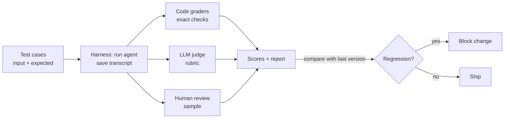

[← Day 10](../../week-2/theory/day-10-code-and-computer-use-agents.md) · [Week 2 overview](../README.md) · [▶️ Practice notebook](../practice/day-11-evals.ipynb) · [Day 12 →](../../week-3/theory/day-12-safety-and-guardrails.md)

## Day 11 — Evals: the skill that separates demos from products

⏱ 75 min theory · 30 min lab · 60 min capstone

**Goals:** design outcome and trajectory evals, use code graders and calibrated LLM judges, understand pass@k vs pass^k, and set up a regression gate.


### 🎥 Watch first (short videos)
- 🎥 [Evals, error analysis, and better prompts](https://www.youtube.com/watch?v=PgzOBNse2EA): *Hamel Husain*. error analysis first (longer; watch the first 20 min)
- 🎥 [How to Build AI Evals in 2026 (Step-by-Step)](https://www.youtube.com/watch?v=J7N9FMouSKg): *Hamel Husain & Shreya Shankar*. real production data walkthrough (longer)

> Durations are approximate. "Community explainer" means an independent creator; the written links in each section are the primary sources.

### 11.1 Why agents need evals (and why they're hard)

**Intuition.** Agents are non-deterministic and multi-step, and small prompt changes have non-local effects. Without evals, every change is a guess: "it felt better in 3 tries". Evals are your unit tests + metrics + regression suite.



### 11.2 What to grade: outcome vs trajectory

| Grade the... | Question | Example check |
|---|---|---|
| **Outcome** | Is the final state/answer right? | DB shows the refund created; reply mentions the 30-day rule |
| **Trajectory** | Did it get there the right way? | Called `check_refund_eligibility` *before* promising; no more than 6 steps; never called `refund` for ineligible orders |
| **Behavior/quality** | Tone, honesty, format | Polite, no invented facts, cites the policy |

Prefer grading **outcomes and key safety-relevant steps**. Grading the *exact* path is brittle, because good agents find different valid paths.

### 11.3 Graders: code first, LLM judge second, humans for calibration

```python
def grade_case(case, transcript, final_text):
    tools_called = [b.name for m in transcript if m["role"] == "assistant"
                    for b in m["content"] if getattr(b, "type", "") == "tool_use"]
    checks = {
        "used_eligibility_tool": "check_refund_eligibility" in tools_called,
        "mentions_order":        case["order_id"] in final_text,
        "no_false_promise":      not (case["eligible"] is False and "refund has been issued" in final_text.lower()),
        "step_budget":           len(tools_called) <= 6,
    }
    return checks
```

**LLM-as-judge done right**
- **Binary, specific questions** beat 1–10 scales: "Did the reply promise anything the policy doesn't allow? yes/no + reason".
- **Calibrate against a human:** label ~30–50 transcripts yourself, run the judge, and measure agreement. Iterate on the judge prompt until agreement is high (>85–90%). Hamel Husain calls a version of this "critique shadowing".
- Use a **different/cheaper model** for judging, and watch for position and verbosity bias.

```python
class Verdict(BaseModel):
    passed: bool
    reason: str

def judge(question, reply, rubric):
    r = client.messages.parse(model=CHEAP_MODEL, max_tokens=800, output_format=Verdict,
        messages=[{"role": "user", "content": f"Rubric: {rubric}\n\nCustomer: {question}\n\nAgent reply: {reply}\n\n"
                                              "Does the reply satisfy the rubric?"}])
    return r.parsed_output
```

### 11.4 The math: pass@k vs pass^k (reliability)

Let *p* = probability the agent solves a task in one try.

$$\text{pass@}k = 1-(1-p)^k \quad(\text{at least one of }k\text{ tries succeeds})$$
$$\text{pass}^k = p^k \quad(\text{all }k\text{ tries succeed} = \text{consistency})$$

| p | pass@5 | pass^5 |
|---|---|---|
| 0.9 | 0.99999 | 0.59 |
| 0.7 | 0.998 | 0.17 |

👉 **pass@k** suits tasks where you can retry and verify (code with tests). **pass^k** is what matters for customer-facing agents: a support bot that's right 90% of the time fails **4 in 10 customers who contact it 5 times**. τ-bench popularized pass^k for exactly this reason.

```python
def pass_at_k(p, k): return 1 - (1 - p) ** k
def pass_hat_k(p, k): return p ** k
print(pass_at_k(0.9, 5), pass_hat_k(0.9, 5))    # 0.99999  0.59049
```

**Statistics hygiene:** with 20 cases, one case = 5 points. Run each case 3–5 times and report mean ± spread. Don't celebrate a 2-point gain on 20 cases.

### 11.5 Building and maintaining the eval set

1. **Start from real transcripts:** your Day 3 transcripts, failures from logs, support-team examples.
2. **Error analysis first:** read ~50 transcripts and categorize failures. The categories *become* your eval dimensions.
3. **Cover:** happy paths, edge cases (missing order id, two orders), policy boundaries (day 30 vs 31), adversarial cases (Day 12), multi-turn cases.
4. **Grow it continuously:** every production bug becomes a new eval case.
5. **Gate releases:** CI runs the suite, and you block a merge if the score drops more than X or any *critical* case fails.

📖 Deep dive: ⭐ [Anthropic — Demystifying evals for AI agents](https://www.anthropic.com/engineering/demystifying-evals-for-ai-agents) · ⭐ [Hamel Husain — Your AI Product Needs Evals](https://hamel.dev/blog/posts/evals/) · [Hamel Husain — Creating an LLM-as-a-Judge that drives results](https://hamel.dev/blog/posts/llm-judge/) · 📄 [τ-bench (2024)](https://arxiv.org/abs/2406.12045) · 🧑‍💻 [DeepLearning.AI — Evaluating AI Agents](https://www.deeplearning.ai/courses/evaluating-ai-agents)

### 🧪 Lab → do it in the practice notebook 11 — Calibrate a judge (30 min)
Label 30 saved transcripts yourself (pass/fail + reason). Run the Haiku judge on them and compute agreement and a confusion matrix. Improve the rubric twice and plot agreement per version.

### 🏗 Capstone — Day 11: `evals/`
- `cases.jsonl`: 20 cases (8 order status, 5 refund edge cases, 3 RAG policy questions, 2 memory, 2 adversarial), each with `input`, `customer_id`, expectations and a `critical` flag.
- `run_evals.py`: runs each case 3×, applies code graders + the judge, writes `report.md` (pass rate, pass^3, cost, p50/p95 latency, failing cases with transcript links) and **exits non-zero on regression**.

From today on, **every change you make gets an eval run.** That's the industry habit to build.

### ✅ Checkpoint
1. Outcome vs trajectory grading: when do you need each?
2. Your agent has p = 0.85. What are pass@3 and pass^3? Which one matters for support?
3. How do you know your LLM judge can be trusted?
4. Where should new eval cases come from after launch?

---

**Next:** open the [practice notebook](../practice/day-11-evals.ipynb) · capstone milestone in [projects/shopease-support-agent](../../projects/shopease-support-agent/README.md#milestones-build-your-own-version-alongside-the-course)

[← Day 10](../../week-2/theory/day-10-code-and-computer-use-agents.md) · [Week 2 overview](../README.md) · [▶️ Practice notebook](../practice/day-11-evals.ipynb) · [Day 12 →](../../week-3/theory/day-12-safety-and-guardrails.md)
